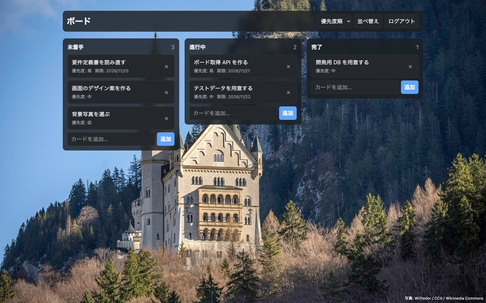

# タスク管理アプリ（カンバンボード）

やることを「未着手」「進行中」「完了」の3つの列に並べ、ドラッグ＆ドロップで動かして管理する、Trello 風のタスク管理アプリです。PC とスマートフォンのどちらからでも、同じボードを見て更新できることを目指しています。



*サーバー版のボード画面。カードは見本のデータ（`backend/dev/seed.sql`）。背景写真: Wilfredor / CC0 / Wikimedia Commons*

- 公開中の試作版（ブラウザだけで動く版）: https://kaitofujitani.github.io/tasukumanezimennto/
- 要件と設計の資料: [docs/](docs/README.md)

## 主な機能

| 機能 | 内容 |
|---|---|
| ログイン | パスワードを入力してから使う（サーバー版） |
| ボード表示 | 3つの列にタスクのカードを並べ、列ごとの件数を表示する |
| タスクの登録・編集・削除 | タイトル・説明・優先度（高・中・低）・期限を持つ |
| 移動・並べ替え | ドラッグ＆ドロップで列の移動と順番の入れ替えができる。スマホでは詳細画面から動かす |
| 自動の並べ替え | 優先度順・期限順などに一度に並べ替える。並べ替えたあとも手で調整できる |
| 背景写真 | 開くたびに世界の名所の写真を1枚選んで背景にする |

詳しくは [機能仕様書](docs/features.md) と [画面設計書](docs/screens.md) を参照してください。

## 今の状態（2つの版）

今は、ブラウザだけで動く試作版から、サーバーとデータベースを使う版へ移している途中です。

| 版 | 場所 | データの保存先 | 状態 |
|---|---|---|---|
| 試作版 | [index.html](index.html)（1ファイル） | ブラウザの localStorage | GitHub Pages で公開中 |
| サーバー版 | [frontend/](frontend/)（画面）と [backend/](backend/)（サーバー） | PostgreSQL | 開発中。公開は Render と Neon を使う予定 |

[mock/index.html](mock/index.html) は、サーバー版の画面の見た目と動きを確かめるために作った見本です。React 版の画面はこれを移したものです。

## 使っている技術

| 区分 | 技術 |
|---|---|
| フロントエンド（画面） | React・TypeScript・Vite・Tailwind CSS |
| | Vitest・React Testing Library（テスト） |
| バックエンド（サーバー） | Java・Spring Boot（Spring Security・Spring Data JPA・Flyway） |
| | Gradle（ビルドツール） |
| データベース | PostgreSQL（開発は Docker、本番は Neon） |
| 開発ツール | Node.js・npm（パッケージ管理）・Git・GitHub |
| 公開 | Docker（画面とサーバーを1つの jar にまとめる）・Render |

それぞれのバージョンと、それを決めているファイルは [技術スタック選定書の「3.4 使っているバージョン」](docs/tech-stack.md#34-使っているバージョン) にまとめています。技術を選んだ理由は同じ資料の前半にあります。バージョンを上げたときは、3.4 の表だけを直してください。

## フォルダ構成

```
.
├── index.html     試作版（HTML・CSS・JavaScript をすべてこの中に書いている）
├── images/        試作版の背景写真と出典（CREDITS.md）
├── mock/          サーバー版の画面の見本
├── frontend/      サーバー版の画面（React + TypeScript + Vite）
├── backend/       サーバー版のサーバー（Java + Spring Boot）と開発用 DB の設定
├── Dockerfile     公開用のイメージを作る（画面とサーバーを1つにまとめる）
└── docs/          要件定義書・設計資料（images/ に README の画面の画像）
```

サーバーのフォルダの中身は [API設計書の「1.3 フォルダ構成」](docs/api.md#13-フォルダ構成) を参照してください。

## 動かし方

### 試作版

サーバーは要りません。`index.html` をブラウザで開くだけで動きます。

```sh
open index.html
# または
python3 -m http.server   # → http://localhost:8000
```

### サーバー版

必要なもの: Docker、Java 25、Node.js 24（npm 付き）

ポートは **画面 5173・サーバー 8080・DB 5432** に固定しています。使われていても別のポートでは起動しないでください（`/api` の転送がずれるため）。使われているときは `bash .claude/skills/dev-up/free-ports.sh` で、使っているプロセスを確かめて止めます。

```sh
# 1. 開発用の PostgreSQL を起動する（ポート 5432）
cd backend
docker compose up -d

# 2. サーバーを起動する（ポート 8080）。APP_PASSWORD がログインのパスワードになる
APP_PASSWORD=好きなパスワード ./gradlew bootRun

# 3. 別のターミナルで画面を起動する（ポート 5173）
cd frontend
npm install
npm run dev
```

http://localhost:5173 を開き、`APP_PASSWORD` に設定したパスワードでログインします。画面からの `/api` は Vite がサーバー（8080）に転送します。

- テーブルは、サーバーの起動時に Flyway が自動で作ります（`backend/src/main/resources/db/migration/`）
- テストデータは、一度 `bootRun` したあとに次のコマンドで入れられます。実行するたびにタスクをすべて消して入れ直します

  ```sh
  cd backend
  docker compose exec -T db psql -U taskboard -d taskboard < dev/seed.sql
  ```

- 止めるときは `bash .claude/skills/dev-up/free-ports.sh --stop`
- 環境変数（`DB_URL`・`DB_USERNAME`・`DB_PASSWORD`・`APP_PASSWORD`・`PORT`）は [API設計書の「1.5 環境変数」](docs/api.md#15-環境変数) を参照してください。`DB_URL` などを設定しなければ、開発用の DB につなぎます

### テストとビルド

```sh
# 画面
cd frontend
npm test          # Vitest + React Testing Library
npm run build     # 型チェックとビルド（dist/ に出力）

# サーバー（Docker Desktop を起動した状態で。テスト用の PostgreSQL は自動で起動する）
cd backend
./gradlew test
```

試作版（`index.html`）には自動テストがないので、ブラウザで操作して確かめます。

## 公開

| 版 | 公開先 | 反映のしかた |
|---|---|---|
| 試作版 | GitHub Pages（`main` ブランチのルート） | `main` にマージすると数分で反映される |
| サーバー版 | Render（Docker）＋ Neon（PostgreSQL） | `main` にマージすると Render が `Dockerfile` でビルドし直す |

手元で公開用のイメージを作るときは `docker build -t taskboard:local .` を実行します。Neon と Render の設定手順は [公開手順書](docs/deploy.md) にまとめています。

## 資料

まず [要件定義書](docs/requirements.md) を読み、詳しいところは次の資料で確認してください（一覧は [docs/README.md](docs/README.md)）。

| 資料 | 内容 |
|---|---|
| [要件定義書](docs/requirements.md) | 目的・背景、機能と画面の概要、非機能要件、受け入れ基準 |
| [機能仕様書](docs/features.md) | 機能一覧（F1〜F11）の詳しい内容、利用シナリオ |
| [画面設計書](docs/screens.md) | 画面一覧、画面の動き、入力のルール、エラー時の表示 |
| [データベース設計書](docs/database.md) | ER図、テーブル定義、データの流れ |
| [API設計書](docs/api.md) | サーバーの構成、API の一覧と詳細、ログインの仕組み |
| [技術スタック選定書](docs/tech-stack.md) | 使う技術と選んだ理由、使っているバージョン |
| [公開手順書](docs/deploy.md) | Neon と Render の設定手順、公開後の確認 |

## 開発の進め方

作業は必ず「Issue → ブランチ → PR → マージ」の順で進めます。`main` への直接の commit・push はできません。

1. `gh issue create` で Issue を作る（ラベルは `enhancement`・`bug`・`documentation`）
2. 最新の `main` から `<type>/#<Issue番号>-<説明>` のブランチを切る（例: `feature/#12-add-login`）
3. コミットは `<type>: <説明>` の形で書く（例: `feat: ログイン機能を追加`）
4. PR の本文に `Closes #<Issue番号>` を書き、確認を受けてからマージする

細かいルールは [CLAUDE.md](CLAUDE.md) の「Git 運用ルール」にあります。
