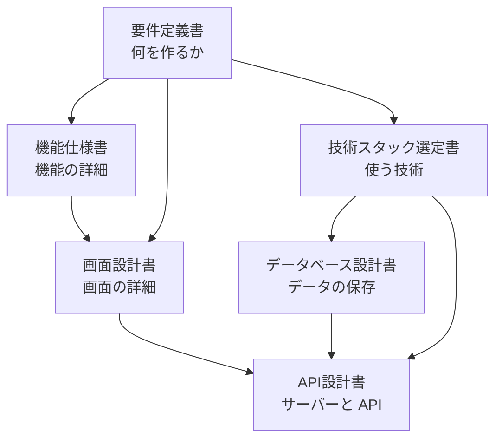

# 資料一覧：タスク管理アプリ（カンバンボード）

まず [要件定義書](requirements.md) を読み、詳しく知りたいところをそれぞれの資料で確認してください。

| 資料 | 内容 | こんなときに読む |
|---|---|---|
| [要件定義書](requirements.md) | 目的・背景、機能と画面の概要、非機能要件、対象外、了承事項、納品物、スケジュール、受け入れ基準 | 何を作るか、どうなったら完成かを知りたい |
| [機能仕様書](features.md) | 機能一覧（F1〜F11）の詳しい内容、利用シナリオ、今後の追加候補 | 各機能が何をするかを知りたい |
| [画面設計書](screens.md) | 画面一覧、画面の移り変わり、画面イメージ、画面の動き、入力のルール、エラー時の表示 | 画面の見た目や操作したときの動きを知りたい |
| [データベース設計書](database.md) | ER図、テーブル定義、データの流れ、タスクの状態の移り変わり | どんなデータをどう保存するかを知りたい |
| [API設計書](api.md) | サーバーの構成、フォルダ構成、環境変数、API の一覧と詳細、ログインの仕組み | 画面とサーバーのやりとりを知りたい |
| [技術スタック選定書](tech-stack.md) | 使う技術と選んだ理由、比べた候補、無料プランの注意点 | なぜその技術を使うのかを知りたい |

## 資料どうしの関係

- 図は Mermaid 記法で書いています。GitHub 上では図として表示されます
