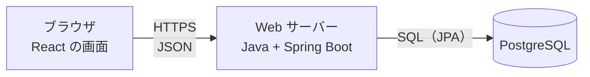
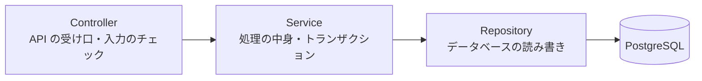
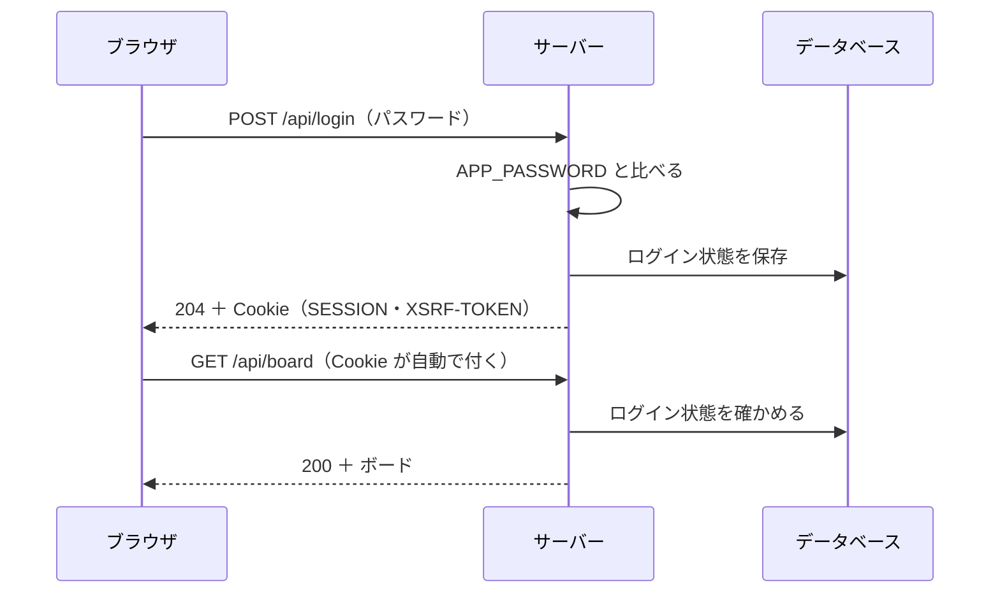

# API設計書：タスク管理アプリ（カンバンボード）

[要件定義書](requirements.md) の「9. システム構成の概要」のうち、サーバーと API の設計を詳しくした資料です。
データベースの設計は [データベース設計書](database.md)、使う技術は [技術スタック選定書](tech-stack.md) を参照してください。

---

## 1. サーバーの全体像

### 1.1 構成



- Web サーバー（Spring Boot）は、画面のファイル（React をビルドした HTML・JavaScript・画像など）の配信と、データを読み書きする API の2つの役割を持つ
- 画面と API を同じサーバーから配信するので、URL がそろい、別サイト間の通信の設定（CORS）がいらない
- データとログイン状態はすべてデータベースに保存する。ブラウザにはタスクのデータを保存しない

### 1.2 サーバーの中の分担



- **Controller**：URL ごとに API を受け、送られた内容を確かめて Service を呼ぶ
- **Service**：並び順の振り直しなど処理の中身を書く。複数の行を書き換える処理はトランザクションで行う
- **Repository**：Spring Data JPA でデータベースを読み書きする

### 1.3 フォルダ構成

```text
/
├── frontend/                          画面（React + TypeScript）
│   ├── src/
│   │   ├── main.tsx                   画面の起点
│   │   ├── App.tsx                    ログイン画面とボード画面の切り替え
│   │   ├── api.ts                     API を呼ぶ処理
│   │   ├── types.ts                   API でやりとりするデータの型
│   │   ├── components/                画面の部品（LoginPage・Board・Column・TaskCard・TaskDetail）
│   │   └── styles.css
│   ├── public/images/                 背景写真
│   ├── package.json                   使うライブラリと、開発・ビルドのコマンド
│   └── vite.config.ts                 開発中は /api を Spring Boot に転送する設定
├── backend/                           サーバー（Java + Spring Boot）
│   ├── src/main/java/com/example/taskboard/
│   │   ├── TaskboardApplication.java  サーバーの起点
│   │   ├── controller/                AuthController・BoardController・TaskController
│   │   ├── service/                   TaskService（登録・移動・並べ替え）
│   │   ├── repository/                BoardColumnRepository・TaskRepository
│   │   ├── entity/                    BoardColumn・Task（テーブルに対応するクラス）
│   │   ├── dto/                       API で受け取る内容・返す内容の形
│   │   └── config/                    SecurityConfig（ログインの設定）・PasswordChecker（パスワードの照合）
│   ├── src/main/resources/
│   │   ├── application.properties     設定（環境変数を読み込む）
│   │   └── db/migration/
│   │       ├── V1__create_tables.sql  テーブルの作成と初期データ（列3つ）
│   │       └── V2__create_session_tables.sql  ログイン状態のテーブル（Spring Session の SQL を写したもの）
│   ├── src/test/java/                 テスト
│   └── build.gradle                   使うライブラリとビルドの設定
├── Dockerfile                         画面をビルドしてサーバーに入れ、1つのアプリにまとめる
└── docs/                              設計資料
```

- 列を表すクラスは `BoardColumn` とする（JPA の `@Column` 注釈と名前が重ならないようにするため）。テーブル名は `columns` のまま

### 1.4 開発と公開の流れ

| 場面 | 動かし方 |
|---|---|
| 開発 | `backend` で `./gradlew bootRun`（ポート 8080）、`frontend` で `npm run dev`（Vite）。画面からの `/api` は Vite が 8080 に転送するので、本番と同じ URL のまま開発できる |
| 公開 | `Dockerfile` が ① `frontend` をビルド ② できたファイルを Spring Boot の `static` に入れる ③ `backend` をビルド ④ 1つの jar ファイルで起動、の順に行う。GitHub の `main` に push すると Render が自動でこの手順を実行する |

### 1.5 環境変数

パスワードや接続情報は、コードや GitHub に置かず、Render の環境変数に設定する。

| 名前 | 内容 |
|---|---|
| `DB_URL` | Neon のデータベースに接続するための URL（`jdbc:postgresql://…?sslmode=require` の形）。未設定なら開発用 DB（`compose.yaml`）につなぐ |
| `DB_USERNAME` | データベースのユーザー名 |
| `DB_PASSWORD` | データベースのパスワード |
| `APP_PASSWORD` | ログインのパスワード（未設定・空だとサーバーが起動しない） |
| `PORT` | サーバーが待ち受ける番号（Render が自動で設定する。`application.properties` で `server.port` に渡す） |
| `JAVA_TOOL_OPTIONS` | Java が使うメモリの上限（例：`-XX:MaxRAMPercentage=75`）。無料プランのメモリが少ないため |

---

## 2. 共通のルール

- URL は `/api/` で始める
- データのやりとりは JSON。項目名は画面側の JavaScript に合わせてキャメルケース（`columnId`）にし、データベースの列名（`column_id`）との変換はサーバーで行う
- ログイン（`/api/login`）以外の API は、ログインしていないと `401` を返す
- 送られた内容は、[画面設計書](screens.md#3-入力のルール) の入力のルールでサーバーでも確かめる
- 送られた内容は、項目に付けた Bean Validation の注釈（`@NotBlank` など）で確かめ、違反なら `400` を返す
- SQL には、送られた値を直接埋め込まない。Spring Data JPA が値をプレースホルダーとして渡す（SQL インジェクション対策）
- ログイン（`/api/login`）以外の `POST`・`PATCH`・`DELETE` では、CSRF 対策のトークンをヘッダーに付けて送る（5章）
- エラーのときは、次の形で理由を返す

```json
{ "error": "タイトルを入力してください" }
```

| 状態コード | 意味 |
|---|---|
| `200` | 成功（内容を返す） |
| `201` | 作成した |
| `204` | 成功（返す内容はない） |
| `400` | 送られた内容が正しくない（入力のルール違反など） |
| `401` | ログインしていない、またはパスワードが違う |
| `403` | CSRF 対策のトークンがない、または正しくない |
| `404` | 指定したタスクがない |
| `500` | サーバーやデータベースのエラー |

---

## 3. API 一覧

| No. | メソッド | URL | 内容 | 使う機能 |
|---|---|---|---|---|
| A1 | `POST` | `/api/login` | ログインする | F1 |
| A2 | `POST` | `/api/logout` | ログアウトする | F1 |
| A3 | `GET` | `/api/board` | 列とタスクをすべて取得する | F2・F9 |
| A4 | `POST` | `/api/tasks` | タスクを登録する | F3 |
| A5 | `PATCH` | `/api/tasks/:id` | タスクの内容（タイトル・説明・優先度・期限）を変える | F4 |
| A6 | `DELETE` | `/api/tasks/:id` | タスクを削除する | F5 |
| A7 | `POST` | `/api/tasks/:id/move` | タスクを別の列や別の位置へ動かす | F6・F7 |
| A8 | `POST` | `/api/tasks/sort` | すべての列を並べ替える | F8 |
| A9 | `GET` | `/api/tasks` | タスクの一覧を取得する（列で絞り込める） | 動作確認・今後の機能用 |
| A10 | `GET` | `/api/tasks/:id` | タスクを1件取得する | 動作確認・今後の機能用 |

---

## 4. 各 API の詳細

### A1 ログインする `POST /api/login`

```json
// 送る内容
{ "password": "入力したパスワード" }
```

- 正しければ `204`。ログイン状態の Cookie（`SESSION`）と、CSRF 対策のトークンの Cookie（`XSRF-TOKEN`）を返す
- 違えば `401`

### A2 ログアウトする `POST /api/logout`

- データベースのログイン状態を消し、Cookie も消して `204`

### A3 ボードを取得する `GET /api/board`

```json
// 返す内容（列もタスクも position の順に並べて返す）
{
  "columns": [
    { "id": 1, "name": "未着手", "position": 0 }
  ],
  "tasks": [
    {
      "id": "3f2c…",
      "columnId": 1,
      "title": "資料を作る",
      "description": "",
      "priority": "high",
      "due": "2026-11-20",
      "position": 0,
      "createdAt": "2026-11-13T09:00:00.000Z"
    }
  ]
}
```

- 期限なしのタスクは `"due": null`

### A4 タスクを登録する `POST /api/tasks`

```json
// 送る内容
{ "columnId": 1, "title": "資料を作る" }
```

- 指定した列の一番下に登録する。優先度は `mid`、説明は空、期限はなし
- タイトルは前後の空白を取り除いて保存する
- 成功したら `201` と、登録したタスク（A3 のタスクと同じ形）を返す
- タイトルが空（空白だけも含む）、または `columnId` がなければ `400`。指定した列がなければ `404`

### A5 タスクの内容を変える `PATCH /api/tasks/:id`

```json
// 送る内容（変える項目だけ送る）
{ "priority": "low", "due": null }
```

- 変えられるのは `title`・`description`・`priority`・`due`。列と並び順は A7 で変える
- 送らなかった項目は変えない。`due` は `null` を送ると期限なしにする（ほかの項目の `null` は「送らなかった」と同じ扱い）
- タイトルは前後の空白を取り除いて保存する。空（空白だけも含む）なら `400`。優先度が `high`・`mid`・`low` 以外、期限が `YYYY-MM-DD` の形でなければ `400`
- `updated_at` を現在日時にする
- 成功したら `200` と、変えたあとのタスクを返す
- 入力のルール違反なら `400`、タスクがなければ `404`

### A6 タスクを削除する `DELETE /api/tasks/:id`

- 成功したら `204`。同じ列の残りのタスクの `position` を振り直す
- タスクがなければ `404`

### A7 タスクを動かす `POST /api/tasks/:id/move`

```json
// 送る内容
{ "columnId": 2, "beforeId": "8a1d…" }
```

- `columnId` の列の、`beforeId` のタスクの直前に入れる。`beforeId` が `null` なら列の一番下に入れる
- ドラッグ＆ドロップ、詳細画面の「列」、「上へ」「下へ」のすべてでこの API を使う
  - 「上へ」：1つ上のタスクを `beforeId` にする
  - 「下へ」：2つ下のタスクを `beforeId` にする（なければ `null`）
- 動かし元と動かし先の列の `position` を、トランザクションで振り直す
- `beforeId` に自分自身を指定したときは何も変えない
- 成功したら `204`。タスクや列、`beforeId` のタスクがなければ `404`。`columnId` がない、または `beforeId` のタスクが動かし先の列にないときは `400`

### A8 並べ替える `POST /api/tasks/sort`

```json
// 送る内容
{ "by": "priority" }
```

| `by` | 並べ方 |
|---|---|
| `priority` | 優先度順（同じ優先度なら期限が近い順、期限なしは後ろ） |
| `due` | 期限順（期限なしは最後。同じ期限なら優先度が高い順） |
| `created` | 登録順 |

- 各列の中で並べ替え、`position` を振り直して保存する（並べ替えの条件はリポジトリのメソッドの `ORDER BY` で指定する）
- 並べ方の条件がすべて同じタスクは、今の並びを保つ
- 成功したら `200` と、A3 と同じ形でボード全体を返す
- `by` がない、または上の3つ以外なら `400`

### A9 タスクの一覧を取得する `GET /api/tasks`

```text
GET /api/tasks              すべてのタスク
GET /api/tasks?columnId=1   指定した列のタスクだけ
```

- 成功したら `200` と、タスクの配列（A3 のタスクと同じ形）を返す。並びは A3 と同じ（列の順 → 列の中の position の順）
- 指定した列がなければ `404`、`columnId` が数字でなければ `400`

### A10 タスクを1件取得する `GET /api/tasks/:id`

- 成功したら `200` と、タスク（A3 のタスクと同じ形）を返す
- タスクがなければ `404`、`id` が UUID の形でなければ `400`

---

## 5. ログインの仕組み

Spring Security と Spring Session JDBC を使う。



- パスワードは1つだけで、環境変数 `APP_PASSWORD` と比べる。比べるときは、かかる時間で中身を推測されない方法（`MessageDigest.isEqual`）を使う。長さの違いも出ないよう、両方を SHA-256 にしてから比べる（`PasswordChecker`）
- `APP_PASSWORD` が未設定・空のときは、サーバーを起動しない（パスワードなしで公開してしまうのを防ぐ）
- 正しければ、Spring Security の「ログイン済み」の状態を作り、Spring Session JDBC がデータベースに保存する。ブラウザには、それを指す番号だけを Cookie（`SESSION`）で渡す。データベースに保存するので、サーバーが休止・再起動してもログインは切れない
- ログインに成功したら、セッションの番号と CSRF 対策のトークンを作り直す（ログイン前の番号やトークンを使い回させない）
- ログイン状態の Cookie の設定

| 設定 | 値 | 理由 |
|---|---|---|
| `HttpOnly` | あり | 画面の JavaScript から読めないようにする |
| `Secure` | HTTPS で受けたときだけ付ける | HTTPS のときだけ送る。Render の前段からの `X-Forwarded-Proto` で判断する（`server.forward-headers-strategy=native`）。開発中の http://localhost では付かない |
| `SameSite` | `Lax` | 他のサイトから API を呼ばれても Cookie を送らない |
| `Max-Age` | 30日 | [機能仕様書](features.md) の F1。データベースのログイン状態の有効期限も30日にする |

- CSRF（他のサイトから勝手に操作させる攻撃）対策として、Spring Security の CSRF 対策を有効にする。トークンは Cookie（`XSRF-TOKEN`、画面から読める）で渡し、画面は `POST`・`PATCH`・`DELETE` のときにその値をヘッダー `X-XSRF-TOKEN` に付けて送る
- パスワードを何度も試されるのを防ぐため、ログインに失敗したら 1 秒待ってから返す
- ログインしていないときの `401` は `{ "error": "ログインしてください" }`、CSRF 対策のトークンがないときの `403` は `{ "error": "CSRF 対策のトークンがないか、正しくありません" }` を返す
- ログアウト（A2）は CSRF 対策のトークンが必要。Cookie（`SESSION`・`XSRF-TOKEN`）を消し、データベースのログイン状態も消す
- `APP_PASSWORD` を変えても、すでにログインしている端末はそのまま使える。すべての端末をログアウトさせたいときは、データベースのログイン状態のテーブル（`spring_session`）の行を削除する
