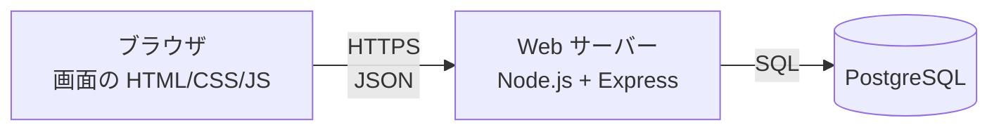

# API設計書：タスク管理アプリ（カンバンボード）

[要件定義書](requirements.md) の「9. システム構成の概要」のうち、サーバーと API の設計を詳しくした資料です。
データベースの設計は [データベース設計書](database.md)、使う技術は [技術スタック選定書](tech-stack.md) を参照してください。

---

## 1. サーバーの全体像

### 1.1 構成



- Web サーバーは、画面のファイル（HTML・画像など）の配信と、データを読み書きする API の2つの役割を持つ
- 画面と API を同じサーバーから配信するので、URL がそろい、別サイト間の通信の設定（CORS）がいらない
- データはすべてデータベースに保存する。ブラウザにはタスクのデータを保存しない

### 1.2 フォルダ構成

```text
/
├── public/              画面のファイル（そのまま配信する）
│   ├── index.html       画面（HTML・CSS・JavaScript）
│   └── images/          背景写真
├── server/
│   ├── app.js           Web サーバーの起動と API の定義
│   ├── db.js            データベースへの接続と SQL の実行
│   └── auth.js          ログインとログイン状態の確認
├── db/
│   └── schema.sql       テーブルの作成と初期データ（列3つ）
├── docs/                設計資料
└── package.json         使うライブラリ（express、pg）と起動コマンド
```

### 1.3 環境変数

パスワードや接続情報は、コードや GitHub に置かず、Render の環境変数に設定する。

| 名前 | 内容 |
|---|---|
| `DATABASE_URL` | Neon のデータベースに接続するための URL |
| `APP_PASSWORD` | ログインのパスワード |
| `SESSION_SECRET` | ログイン状態の Cookie に署名するための秘密の文字列（長いランダムな文字列） |
| `PORT` | サーバーが待ち受ける番号（Render が自動で設定する） |

---

## 2. 共通のルール

- URL は `/api/` で始める
- データのやりとりは JSON。項目名は画面側の JavaScript に合わせてキャメルケース（`columnId`）にし、データベースの列名（`column_id`）との変換はサーバーで行う
- ログイン（`/api/login`）以外の API は、ログインしていないと `401` を返す
- 送られた内容は、[画面設計書](screens.md#3-入力のルール) の入力のルールでサーバーでも確かめる
- SQL には、送られた値を直接埋め込まず、プレースホルダー（`$1` など）で渡す（SQL インジェクション対策）
- エラーのときは、次の形で理由を返す

```json
{ "error": "タイトルを入力してください" }
```

| 状態コード | 意味 |
|---|---|
| `200` | 成功（内容を返す） |
| `201` | 作成した |
| `204` | 成功（返す内容はない） |
| `400` | 送られた内容が正しくない（入力のルール違反など） |
| `401` | ログインしていない、またはパスワードが違う |
| `404` | 指定したタスクがない |
| `500` | サーバーやデータベースのエラー |

---

## 3. API 一覧

| No. | メソッド | URL | 内容 | 使う機能 |
|---|---|---|---|---|
| A1 | `POST` | `/api/login` | ログインする | F1 |
| A2 | `POST` | `/api/logout` | ログアウトする | F1 |
| A3 | `GET` | `/api/board` | 列とタスクをすべて取得する | F2・F9 |
| A4 | `POST` | `/api/tasks` | タスクを登録する | F3 |
| A5 | `PATCH` | `/api/tasks/:id` | タスクの内容（タイトル・説明・優先度・期限）を変える | F4 |
| A6 | `DELETE` | `/api/tasks/:id` | タスクを削除する | F5 |
| A7 | `POST` | `/api/tasks/:id/move` | タスクを別の列や別の位置へ動かす | F6・F7 |
| A8 | `POST` | `/api/tasks/sort` | すべての列を並べ替える | F8 |

---

## 4. 各 API の詳細

### A1 ログインする `POST /api/login`

```json
// 送る内容
{ "password": "入力したパスワード" }
```

- 正しければ `204`。ログイン状態の Cookie を返す
- 違えば `401`

### A2 ログアウトする `POST /api/logout`

- ログイン状態の Cookie を消して `204`

### A3 ボードを取得する `GET /api/board`

```json
// 返す内容（列もタスクも position の順に並べて返す）
{
  "columns": [
    { "id": 1, "name": "未着手", "position": 0 }
  ],
  "tasks": [
    {
      "id": "3f2c…",
      "columnId": 1,
      "title": "資料を作る",
      "description": "",
      "priority": "high",
      "due": "2026-11-20",
      "position": 0,
      "createdAt": "2026-11-13T09:00:00.000Z"
    }
  ]
}
```

- 期限なしのタスクは `"due": null`

### A4 タスクを登録する `POST /api/tasks`

```json
// 送る内容
{ "columnId": 1, "title": "資料を作る" }
```

- 指定した列の一番下に登録する。優先度は `mid`、説明は空、期限はなし
- 成功したら `201` と、登録したタスク（A3 のタスクと同じ形）を返す
- タイトルが空なら `400`

### A5 タスクの内容を変える `PATCH /api/tasks/:id`

```json
// 送る内容（変える項目だけ送る）
{ "priority": "low", "due": null }
```

- 変えられるのは `title`・`description`・`priority`・`due`。列と並び順は A7 で変える
- `updated_at` を現在日時にする
- 成功したら `200` と、変えたあとのタスクを返す
- 入力のルール違反なら `400`、タスクがなければ `404`

### A6 タスクを削除する `DELETE /api/tasks/:id`

- 成功したら `204`。同じ列の残りのタスクの `position` を振り直す
- タスクがなければ `404`

### A7 タスクを動かす `POST /api/tasks/:id/move`

```json
// 送る内容
{ "columnId": 2, "beforeId": "8a1d…" }
```

- `columnId` の列の、`beforeId` のタスクの直前に入れる。`beforeId` が `null` なら列の一番下に入れる
- ドラッグ＆ドロップ、詳細画面の「列」、「上へ」「下へ」のすべてでこの API を使う
  - 「上へ」：1つ上のタスクを `beforeId` にする
  - 「下へ」：2つ下のタスクを `beforeId` にする（なければ `null`）
- 動かし元と動かし先の列の `position` を、トランザクションで振り直す
- 成功したら `204`。タスクや列がなければ `404`

### A8 並べ替える `POST /api/tasks/sort`

```json
// 送る内容
{ "by": "priority" }
```

| `by` | 並べ方 |
|---|---|
| `priority` | 優先度順（同じ優先度なら期限が近い順、期限なしは後ろ） |
| `due` | 期限順（期限なしは最後。同じ期限なら優先度が高い順） |
| `created` | 登録順 |

- 各列の中で並べ替え、`position` を振り直して保存する（SQL の `ORDER BY` で並べる）
- 成功したら `200` と、A3 と同じ形でボード全体を返す

---

## 5. ログインの仕組み

- パスワードは1つだけで、環境変数 `APP_PASSWORD` と比べる。比べるときは、かかる時間で中身を推測されない方法（`crypto.timingSafeEqual`）を使う
- 正しければ、有効期限（30日後）に `SESSION_SECRET` で署名を付けた値を Cookie に入れて返す。サーバーは Cookie の署名と期限を確かめるだけなので、ログイン状態をデータベースに保存しなくてよい（サーバーが再起動してもログインは切れない）
- Cookie の設定

| 設定 | 値 | 理由 |
|---|---|---|
| `HttpOnly` | あり | 画面の JavaScript から読めないようにする |
| `Secure` | あり | HTTPS のときだけ送る |
| `SameSite` | `Lax` | 他のサイトから API を呼ばれても Cookie を送らない |
| `Max-Age` | 30日 | [機能仕様書](features.md) の F1 |

- パスワードを何度も試されるのを防ぐため、ログインに失敗したら 1 秒待ってから返す
- `APP_PASSWORD` を変えても、すでに配った Cookie は期限まで使える。すべての端末をログアウトさせたいときは `SESSION_SECRET` を変える
