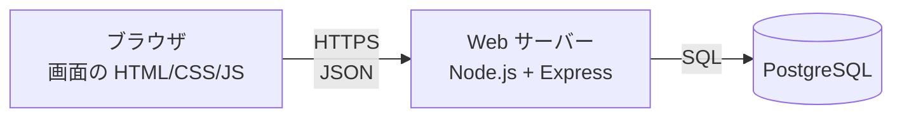
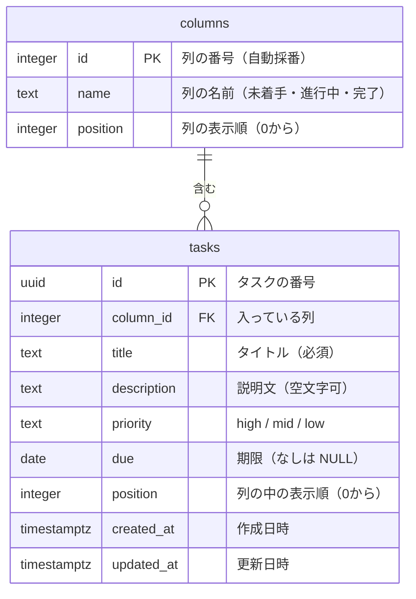
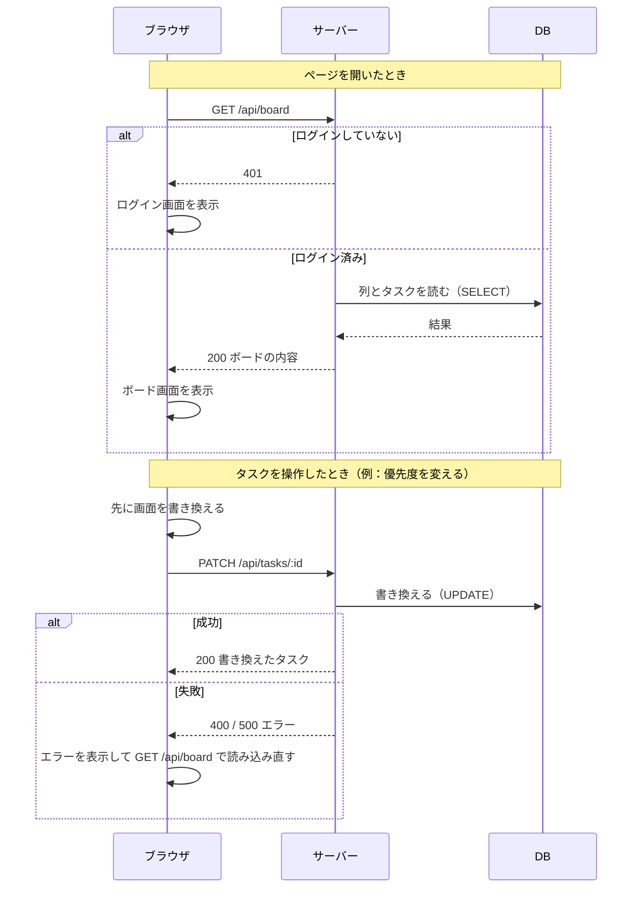
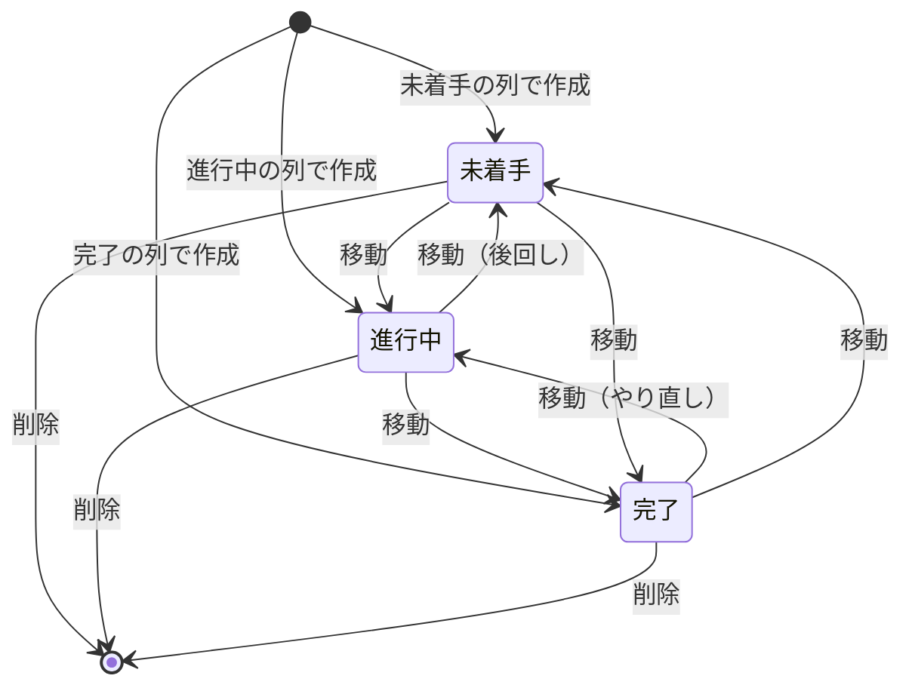

# 基本設計書: タスク管理アプリ（Trello風）

[要件定義書](requirements.md) で決めた「何を作るか」をもとに、「どう作るか」を決める。
画面一覧・画面遷移図・ワイヤーフレームは要件定義書の 5章、使う技術は [技術スタック選定書](tech-stack.md) を参照。

---

## 1. 全体の仕組み

### 1.1 構成



- Web サーバーは、画面のファイル（HTML・画像など）の配信と、データを読み書きする API の2つの役割を持つ
- 画面は1枚の HTML で、ログイン画面とボード画面を切り替えて表示する（ページの移動はしない）
- データはすべて DB に保存する。ブラウザにはタスクのデータを保存しない

### 1.2 フォルダ構成

```text
/
├── public/              画面のファイル（そのまま配信する）
│   ├── index.html       画面（HTML・CSS・JavaScript）
│   └── images/          背景写真
├── server/
│   ├── app.js           Web サーバーの起動と API の定義
│   ├── db.js            DB への接続と SQL の実行
│   └── auth.js          ログインとログイン状態の確認
├── db/
│   └── schema.sql       テーブルの作成と初期データ（列3つ）
├── docs/                設計資料
└── package.json         使うライブラリ（express、pg）と起動コマンド
```

### 1.3 環境変数

パスワードや接続情報は、コードや GitHub に置かず、Render の環境変数に設定する。

| 名前 | 内容 |
|---|---|
| `DATABASE_URL` | Neon の DB に接続するための URL |
| `APP_PASSWORD` | ログインのパスワード |
| `SESSION_SECRET` | ログイン状態の Cookie に署名するための秘密の文字列（長いランダムな文字列） |
| `PORT` | サーバーが待ち受ける番号（Render が自動で設定する） |

---

## 2. 画面設計

### 2.1 画面要素の振る舞い

#### 共通：データの保存のしかた

- 操作したら、先に画面を書き換え、そのあと API でサーバーに保存する（操作のたびに待たされないようにするため）
- 保存に失敗したら、エラーを表示し、ボードを DB の内容で読み込み直す（画面と DB の食い違いをなくすため）
- タイトルと説明文は、1文字ごとではなく、入力が 0.5 秒止まったときにまとめて保存する（通信の回数を減らすため）

#### S0 ログイン画面

| 要素 | 操作 | 振る舞い |
|---|---|---|
| 画面全体 | 表示 | ページを開いたときに、ログインしていなければ表示する |
| パスワード | 入力 | 入力した文字は「•」で隠す |
| ログインボタン | 押す／Enter | パスワードが正しければボード画面を表示する。間違っていれば「パスワードが違います」と表示し、入力欄を空にする |

#### S1 ボード画面

| 要素 | 操作 | 振る舞い |
|---|---|---|
| 画面全体 | 表示 | ページを開いたら、DB からボードの内容を読み込んで表示する。読み込みに3秒以上かかったら「サーバーを起動しています。1分ほどかかることがあります」と表示する |
| 並べ方（選択肢） | 選ぶ | 「優先度順」「期限順」「作成順」から選ぶ。選んだだけでは並び替えない |
| 並べ替えボタン | 押す | 選んだ並べ方で全カラムを並べ替え、その順番を保存する |
| ログアウトボタン | 押す | ログアウトして、ログイン画面を表示する |
| カラムの見出し | — | カラム名と、そのカラムのタスク件数を表示する |
| カード | 表示 | タイトル、優先度を表示する。期限は設定されているときだけ「期限: YYYY/MM/DD」で表示する |
| カード | クリック／Enter | S2 タスク詳細画面を開く |
| カード | ドラッグ | ドラッグ中のカードを薄く表示し、落とす位置に青い線を出す。落とすと、その位置に移動して保存する。カラムの上にあるときは、そのカラムの枠を青くする |
| 「×」ボタン | 押す | 確認なしでタスクを削除する |
| 入力欄・追加ボタン | Enter／押す | そのカラムの末尾にタスクを作成する。優先度は「中」、説明文と期限は空にする。作成後も入力欄にカーソルを残す |
| クレジット | クリック | 背景写真の出典ページを新しいタブで開く |

#### S2 タスク詳細画面

| 要素 | 操作 | 振る舞い |
|---|---|---|
| 画面全体 | 開く | ボード画面の上に重ねて表示し、後ろを暗くする。開いている間はボード画面を操作できない |
| タイトル | 入力 | 入力が 0.5 秒止まったら保存し、ボード画面にも反映する |
| 説明文 | 入力 | 入力が 0.5 秒止まったら保存する |
| 優先度・期限 | 変更 | 変更した時点で保存する。期限はブラウザ標準の日付選択を使う |
| 列 | 変更 | 選んだカラムの末尾に移動して保存する |
| 上へ／下へ | 押す | 同じカラムの隣のタスクと順番を入れ替える。先頭のときは「上へ」、末尾のときは「下へ」を押せなくする |
| 削除ボタン | 押す | 「『タイトル』を削除しますか？」と確認し、OK なら削除して画面を閉じる |
| 閉じるボタン／Esc／外側のクリック | 押す | まだ保存していない入力があれば保存してから、画面を閉じる |

### 2.2 入力ルール

画面とサーバーの両方で同じルールを確かめる。画面での確認は使いやすさのため、サーバーでの確認は正しくないデータを DB に入れないため。

| 項目 | 必須 | ルール |
|---|---|---|
| タイトル | 必須 | 前後の空白は取り除いて保存する。空白だけのものは空とみなす。文字数の上限は設けない |
| 説明文 | 任意 | 入力したまま保存する（前後の空白も残す）。改行できる。文字数の上限は設けない |
| 優先度 | 必須 | 「高」「中」「低」から選ぶ。作成時は「中」 |
| 期限 | 任意 | ブラウザ標準の日付選択で入力する。過去の日付も設定できる（期限切れのタスクを登録できるようにするため）。空にすると期限なし |
| 列 | 必須 | 「未着手」「進行中」「完了」から選ぶ。作成時は入力したカラム |

### 2.3 入力ミス・エラー時の表示

エラーのメッセージは、画面の上部に帯で表示し、5秒後に消す（ログイン画面のメッセージは入力欄の下に出す）。

| 状況 | 表示・振る舞い |
|---|---|
| タイトルを入れずに追加しようとした（空白だけも含む） | 何も作らない。メッセージは出さない |
| 詳細画面でタイトルを空にした | 空の間は保存しない。入力欄から離れると元のタイトルに戻す |
| パスワードが違う | 「パスワードが違います」と表示する |
| ログインの期限が切れた（API が 401 を返した） | ログイン画面を表示する |
| 通信できない・サーバーがエラーを返した | 「保存できませんでした。通信状況を確認してください」と表示し、ボードを読み込み直す |
| ボードの読み込みに失敗した | 「読み込めませんでした」と表示し、「再読み込み」ボタンを出す |
| 背景写真が読み込めない | 写真なしの通常の配色で表示する。クレジットも出さない |

---

## 3. データ設計

### 3.1 ER図

ユーザーは1人だけなので、ユーザーの表は作らない。



- 1つの列には、0個以上のタスクが入る。1つのタスクは、必ず1つの列に入る（1対多）

### 3.2 テーブル定義

#### columns（列）

| 列名 | 型 | 制約 | 説明 |
|---|---|---|---|
| `id` | `integer` | 主キー、自動採番 | 列の番号 |
| `name` | `text` | NOT NULL | 列の名前 |
| `position` | `integer` | NOT NULL、重複不可 | 列の表示順。小さいほど左（スマホでは上） |

- 初期データとして「未着手」「進行中」「完了」の3行を入れる
- 列の追加・削除・名前変更は今回の対象外なので、画面からは変更しない

#### tasks（タスク）

| 列名 | 型 | 制約 | 説明 |
|---|---|---|---|
| `id` | `uuid` | 主キー、初期値は自動で作る | タスクの番号 |
| `column_id` | `integer` | NOT NULL、外部キー（`columns.id`） | 入っている列 |
| `title` | `text` | NOT NULL、空文字不可 | タイトル（前後の空白は取り除いて保存） |
| `description` | `text` | NOT NULL、初期値 `''` | 説明文 |
| `priority` | `text` | NOT NULL、`'high'`・`'mid'`・`'low'` のどれか、初期値 `'mid'` | 優先度 |
| `due` | `date` | NULL 可 | 期限。期限なしは NULL |
| `position` | `integer` | NOT NULL | 列の中の表示順。小さいほど上 |
| `created_at` | `timestamptz` | NOT NULL、初期値は現在日時 | 作成日時 |
| `updated_at` | `timestamptz` | NOT NULL、初期値は現在日時 | 最後に更新した日時 |

### 3.3 設計で決めたこと

- **並び順は `position` で持つ**：DB の行には順番がないため、数値の項目で持つ。移動や並べ替えをしたら、その列のタスクの `position` を 0, 1, 2… と振り直す
- **並び順の書き換えはまとめて行う**：移動では2つの列の `position` を同時に書き換えるので、トランザクション（全部成功するか、全部取り消すかのどちらか）で行う
- **優先度は表にしない**：「高・中・低」の3つで増やす予定がないため、`priority` 列に入れられる値を制約で3つに限定する。表示名（高・中・低）は画面側の対応表で持つ
- **列は表にする**：タスクとの1対多の関係を DB で表し、存在しない列にタスクが入らないよう外部キーで守る
- **タスクが入っている列は削除できない**：外部キーの初期設定の動きのまま（列の削除自体が今回は対象外）

### 3.4 データの流れ

ページを開いたときにボード全体を読み込み、そのあとは操作ごとに API を呼んで DB を書き換える。



### 3.5 タスクの状態遷移

タスクはどのカラムからどのカラムへも移動でき、どのカラムからでも削除できる。



- 「移動」は、PC ではドラッグ＆ドロップ、スマホでは詳細画面の「列」で行う
- 「完了」に移しても、自動で削除したり書き換えたりはしない

---

## 4. API 設計

### 4.1 共通のルール

- URL は `/api/` で始める
- データのやりとりは JSON。項目名は画面側の JavaScript に合わせてキャメルケース（`columnId`）にし、DB の列名（`column_id`）との変換はサーバーで行う
- ログイン（`/api/login`）以外の API は、ログインしていないと `401` を返す
- エラーのときは、次の形で理由を返す

```json
{ "error": "タイトルを入力してください" }
```

| 状態コード | 意味 |
|---|---|
| `200` | 成功（内容を返す） |
| `201` | 作成した |
| `204` | 成功（返す内容はない） |
| `400` | 送られた内容が正しくない（入力ルール違反など） |
| `401` | ログインしていない、またはパスワードが違う |
| `404` | 指定したタスクがない |
| `500` | サーバーや DB のエラー |

### 4.2 API 一覧

| No. | メソッド | URL | 内容 |
|---|---|---|---|
| A1 | `POST` | `/api/login` | ログインする |
| A2 | `POST` | `/api/logout` | ログアウトする |
| A3 | `GET` | `/api/board` | 列とタスクをすべて取得する |
| A4 | `POST` | `/api/tasks` | タスクを作成する |
| A5 | `PATCH` | `/api/tasks/:id` | タスクの内容（タイトル・説明文・優先度・期限）を変える |
| A6 | `DELETE` | `/api/tasks/:id` | タスクを削除する |
| A7 | `POST` | `/api/tasks/:id/move` | タスクを別の列や別の位置へ動かす |
| A8 | `POST` | `/api/tasks/sort` | すべての列を並べ替える |

### 4.3 各 API の詳細

#### A1 ログインする `POST /api/login`

```json
// 送る内容
{ "password": "入力したパスワード" }
```

- 正しければ `204`。ログイン状態の Cookie を返す
- 違えば `401`

#### A2 ログアウトする `POST /api/logout`

- ログイン状態の Cookie を消して `204`

#### A3 ボードを取得する `GET /api/board`

```json
// 返す内容（列もタスクも position の順に並べて返す）
{
  "columns": [
    { "id": 1, "name": "未着手", "position": 0 }
  ],
  "tasks": [
    {
      "id": "3f2c…",
      "columnId": 1,
      "title": "資料を作る",
      "description": "",
      "priority": "high",
      "due": "2026-11-20",
      "position": 0,
      "createdAt": "2026-11-13T09:00:00.000Z"
    }
  ]
}
```

- 期限なしのタスクは `"due": null`

#### A4 タスクを作成する `POST /api/tasks`

```json
// 送る内容
{ "columnId": 1, "title": "資料を作る" }
```

- 指定した列の末尾に作る。優先度は `mid`、説明文は空、期限はなし
- 成功したら `201` と、作ったタスク（A3 のタスクと同じ形）を返す
- タイトルが空なら `400`

#### A5 タスクの内容を変える `PATCH /api/tasks/:id`

```json
// 送る内容（変える項目だけ送る）
{ "priority": "low", "due": null }
```

- 変えられるのは `title`・`description`・`priority`・`due`。列と並び順は A7 で変える
- `updated_at` を現在日時にする
- 成功したら `200` と、変えたあとのタスクを返す
- 入力ルール違反なら `400`、タスクがなければ `404`

#### A6 タスクを削除する `DELETE /api/tasks/:id`

- 成功したら `204`。同じ列の残りのタスクの `position` を振り直す
- タスクがなければ `404`

#### A7 タスクを動かす `POST /api/tasks/:id/move`

```json
// 送る内容
{ "columnId": 2, "beforeId": "8a1d…" }
```

- `columnId` の列の、`beforeId` のタスクの直前に入れる。`beforeId` が `null` なら列の末尾に入れる
- ドラッグ＆ドロップ、詳細画面の「列」、「上へ」「下へ」のすべてでこの API を使う
  - 「上へ」：1つ上のタスクを `beforeId` にする
  - 「下へ」：2つ下のタスクを `beforeId` にする（なければ `null`）
- 動かし元と動かし先の列の `position` を、トランザクションで振り直す
- 成功したら `204`。タスクや列がなければ `404`

#### A8 並べ替える `POST /api/tasks/sort`

```json
// 送る内容
{ "by": "priority" }
```

| `by` | 並べ方 |
|---|---|
| `priority` | 優先度順（同じ優先度なら期限が近い順、期限なしは後ろ） |
| `due` | 期限順（期限なしは最後。同じ期限なら優先度が高い順） |
| `created` | 作成順 |

- 各列の中で並べ替え、`position` を振り直して保存する（SQL の `ORDER BY` で並べる）
- 成功したら `200` と、A3 と同じ形でボード全体を返す

---

## 5. ログインの設計

- パスワードは1つだけで、環境変数 `APP_PASSWORD` と比べる。比べるときは、かかる時間で中身を推測されない方法（`crypto.timingSafeEqual`）を使う
- 正しければ、有効期限（30日後）に `SESSION_SECRET` で署名を付けた値を Cookie に入れて返す。サーバーは Cookie の署名と期限を確かめるだけなので、ログイン状態を DB に保存しなくてよい（サーバーが再起動してもログインは切れない）
- Cookie の設定

| 設定 | 値 | 理由 |
|---|---|---|
| `HttpOnly` | あり | 画面の JavaScript から読めないようにする |
| `Secure` | あり | HTTPS のときだけ送る |
| `SameSite` | `Lax` | 他のサイトから API を呼ばれても Cookie を送らない |
| `Max-Age` | 30日 | 要件定義書 3.4 |

- パスワードを何度も試されるのを防ぐため、ログインに失敗したら 1 秒待ってから返す
- `APP_PASSWORD` を変えても、すでに配った Cookie は期限まで使える。全員をログアウトさせたいときは `SESSION_SECRET` を変える

---

## 付録: 今の版（localStorage 版）のデータ

DB 版に移る前の版では、タスクの配列を localStorage のキー `board.v1` に JSON で保存している。

| 今の版の項目 | DB 版での扱い |
|---|---|
| `id` | `tasks.id` |
| `title`・`description`・`priority` | 同じ名前の列 |
| `due`（`""` は期限なし） | `tasks.due`（期限なしは NULL） |
| `status`（`todo`・`doing`・`done`） | `tasks.column_id`（「未着手」「進行中」「完了」の列の id） |
| `created`（ミリ秒） | `tasks.created_at` |
| 配列の中の順番 | `tasks.position` |

今の版のデータを DB に移すかどうかは未定。
