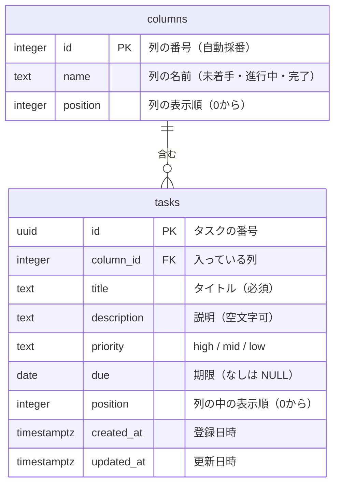
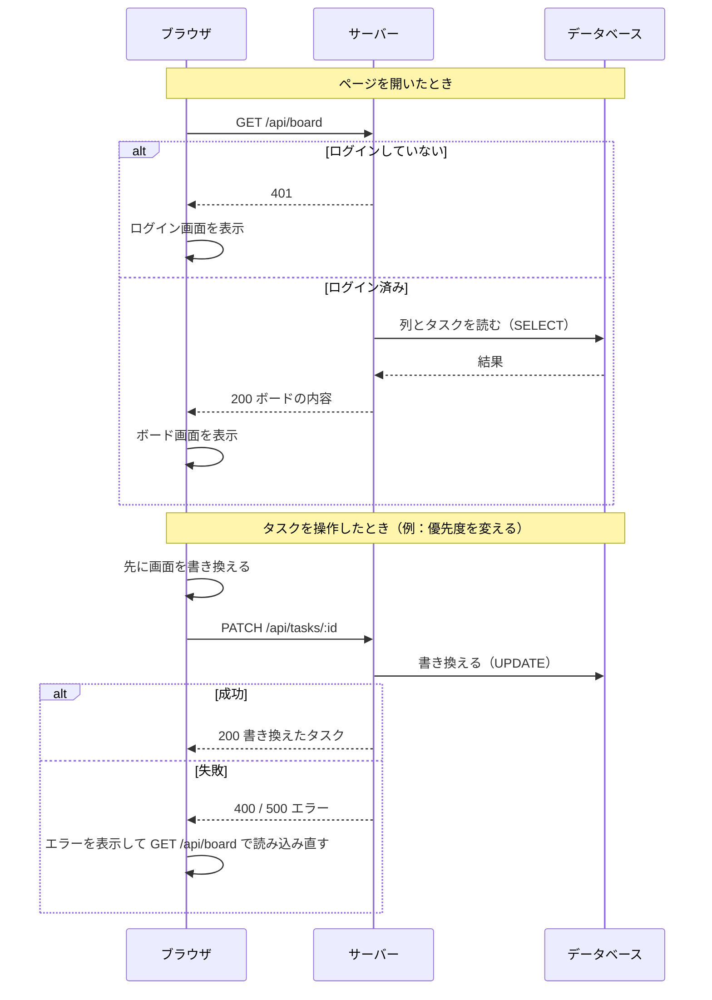
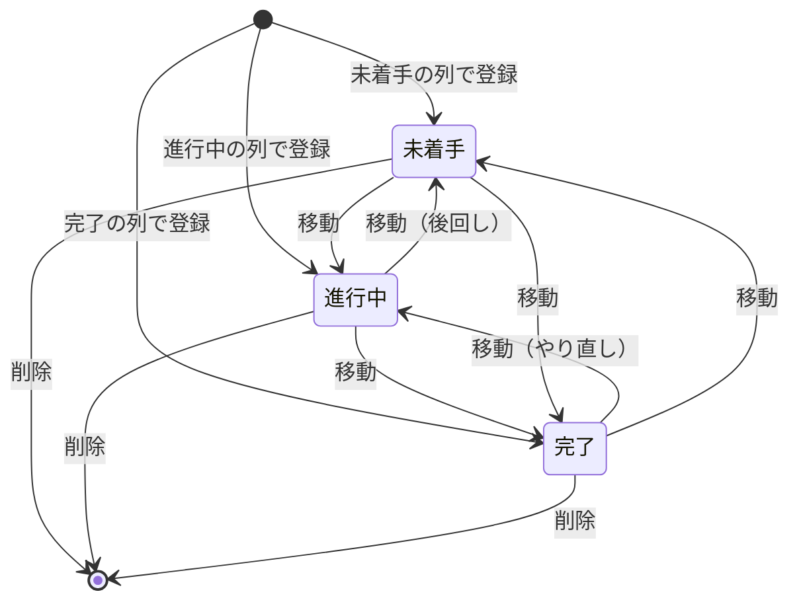

# データベース設計書：タスク管理アプリ（カンバンボード）

[要件定義書](requirements.md) の「9. システム構成の概要」のうち、データベースの設計を詳しくした資料です。
データベースは PostgreSQL を使います（選んだ理由は [技術スタック選定書](tech-stack.md)）。

---

## 1. ER図

ユーザーは1人だけなので、ユーザーの表は作らない。

- 1つの列には、0個以上のタスクが入る。1つのタスクは、必ず1つの列に入る（1対多）

---

## 2. テーブル定義

### 2.1 columns（列）

| 列名 | 型 | 制約 | 説明 |
|---|---|---|---|
| `id` | `integer` | 主キー、自動採番 | 列の番号 |
| `name` | `text` | NOT NULL | 列の名前 |
| `position` | `integer` | NOT NULL、重複不可 | 列の表示順。小さいほど左（スマホでは上） |

- 初期データとして「未着手」「進行中」「完了」の3行を入れる
- 列の追加・削除・名前の変更は今回の対象外なので、画面からは変更しない

### 2.2 tasks（タスク）

| 列名 | 型 | 制約 | 説明 |
|---|---|---|---|
| `id` | `uuid` | 主キー、初期値は自動で作る | タスクの番号 |
| `column_id` | `integer` | NOT NULL、外部キー（`columns.id`） | 入っている列 |
| `title` | `text` | NOT NULL、空文字不可 | タイトル（前後の空白は取り除いて保存） |
| `description` | `text` | NOT NULL、初期値 `''` | 説明 |
| `priority` | `text` | NOT NULL、`'high'`・`'mid'`・`'low'` のどれか、初期値 `'mid'` | 優先度 |
| `due` | `date` | NULL 可 | 期限。期限なしは NULL |
| `position` | `integer` | NOT NULL | 列の中の表示順。小さいほど上 |
| `created_at` | `timestamptz` | NOT NULL、初期値は現在日時 | 登録日時 |
| `updated_at` | `timestamptz` | NOT NULL、初期値は現在日時 | 最後に更新した日時 |

---

## 3. 設計で決めたこと

- **並び順は `position` で持つ**：データベースの行には順番がないため、数値の項目で持つ。移動や並べ替えをしたら、その列のタスクの `position` を 0, 1, 2… と振り直す
- **並び順の書き換えはまとめて行う**：移動では2つの列の `position` を同時に書き換えるので、トランザクション（全部成功するか、全部取り消すかのどちらか）で行う
- **優先度は表にしない**：「高・中・低」の3つで増やす予定がないため、`priority` 列に入れられる値を制約で3つに限定する。表示名（高・中・低）は画面側の対応表で持つ
- **列は表にする**：タスクとの1対多の関係をデータベースで表し、存在しない列にタスクが入らないよう外部キーで守る
- **タスクが入っている列は削除できない**：外部キーの初期設定の動きのまま（列の削除自体が今回は対象外）
- **テーブルの作成は SQL ファイルで管理する**：`db/schema.sql` にテーブルの作成と初期データを書き、同じ手順で作り直せるようにする

---

## 4. データの流れ

ページを開いたときにボード全体を読み込み、そのあとは操作ごとに API を呼んでデータベースを書き換える。API の詳細は [API設計書](api.md) を参照。

| 操作 | データベースの変え方 |
|---|---|
| 登録 | `tasks` に1行追加する。`position` はその列の最後の番号＋1 |
| 編集 | その行の項目と `updated_at` を書き換える |
| 移動（ドラッグ＆ドロップ、列の変更、上へ・下へ） | `column_id` を書き換え、動かし元と動かし先の列の `position` を振り直す |
| 自動の並べ替え | 列ごとに選んだ順で並べ（`ORDER BY`）、`position` を振り直す |
| 削除 | その行を削除し、同じ列の残りの `position` を振り直す |

---

## 5. タスクの状態の移り変わり

タスクはどの列からどの列へも移動でき、どの列からでも削除できる。

- 「完了」に移しても、自動で削除したり書き換えたりはしない

---

## 6. 今後の拡張（複数人での利用）

今回は対象外だが、複数人で使えるようにするときは次のように変える。

- `users`（ユーザー）の表を追加する
- `tasks` と `columns` に、だれのデータかを表す `user_id` を追加する
- すべての SQL で、ログインしているユーザーのデータだけを読み書きするようにする

---

## 付録：今の版（localStorage 版）のデータとの対応

データベースに移る前の版では、タスクの配列をブラウザの localStorage（キー `board.v1`）に JSON で保存している。

| 今の版の項目 | データベースでの扱い |
|---|---|
| `id` | `tasks.id` |
| `title`・`description`・`priority` | 同じ名前の列 |
| `due`（`""` は期限なし） | `tasks.due`（期限なしは NULL） |
| `status`（`todo`・`doing`・`done`） | `tasks.column_id`（「未着手」「進行中」「完了」の列の id） |
| `created`（ミリ秒） | `tasks.created_at` |
| 配列の中の順番 | `tasks.position` |

今の版のデータをデータベースに移すかどうかは未定。
