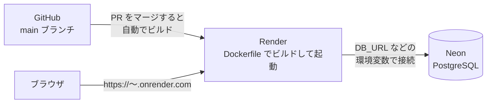

# 公開手順書：タスク管理アプリ（カンバンボード）

[API設計書](api.md) の「1.4 開発と公開の流れ」を、実際に公開するための手順にした資料です。
使うサービスと選んだ理由は [技術スタック選定書](tech-stack.md) を参照してください。

---

## 1. 全体の流れ



- リポジトリのルートの `Dockerfile` が、① 画面をビルド ② できたファイルを Spring Boot の `static` に入れる ③ サーバーをビルド ④ 1つの jar で起動、の順に行う
- テーブルは、サーバーの起動時に Flyway が自動で作る（`backend/src/main/resources/db/migration/`）。Neon で SQL を実行する必要はない
- 最初の1回だけ、下の 2章・3章の設定を行う。そのあとは PR を `main` にマージするたびに、Render が自動で公開し直す

---

## 2. Neon（データベース）の準備

1. [Neon](https://neon.com/) にサインアップする（GitHub のアカウントで登録できる）
2. 新しいプロジェクトを作る
   - Postgres のバージョン：選べる中で最新のもの
   - リージョン：日本から近いところ（例：AWS Asia Pacific (Singapore)）。Render と同じ地域にすると通信が速い
3. プロジェクトの「Connect」（接続情報）を開き、次の値を控える
   - **接続のプールは使わない設定（Connection pooling をオフ）** の接続先を使う。プールありの接続先（ホスト名に `-pooler` が付く）は、Flyway のテーブル作成やサーバー側の接続の使い回しと相性が悪いため
   - ホスト名（例：`ep-xxxx-123456.ap-southeast-1.aws.neon.tech`）
   - データベース名（例：`neondb`）
   - ユーザー名・パスワード
4. 控えた値から、サーバーに渡す接続先（`DB_URL`）を作る。ユーザー名とパスワードは URL に入れず、別の環境変数で渡す

```text
jdbc:postgresql://<ホスト名>/<データベース名>?sslmode=require
```

---

## 3. Render（サーバー）の準備

1. [Render](https://render.com/) に GitHub のアカウントでサインアップし、このリポジトリへのアクセスを許可する
2. 「New」→「Web Service」を選び、このリポジトリを選ぶ
3. 次のように設定する

| 項目 | 値 |
|---|---|
| Name | 好きな名前（公開 URL の `https://<Name>.onrender.com` になる） |
| Branch | `main` |
| Language（Runtime） | Docker |
| Dockerfile Path | `./Dockerfile`（リポジトリのルート） |
| Region | Neon と同じ地域（例：Singapore） |
| Instance Type | Free |
| Health Check Path | `/`（画面の index.html。`/api/` はログインしていないと 401 を返すので使わない） |
| Auto-Deploy | On（`main` が更新されたら自動で公開し直す） |

4. 「Environment」に環境変数を登録する（値はコードや GitHub に置かない。[API設計書](api.md) の 1.5）

| 名前 | 値 |
|---|---|
| `DB_URL` | 2章で作った `jdbc:postgresql://…?sslmode=require` |
| `DB_USERNAME` | Neon のユーザー名 |
| `DB_PASSWORD` | Neon のパスワード |
| `APP_PASSWORD` | ログインのパスワード。推測されにくい長いものにする（未設定・空だとサーバーが起動しない） |
| `JAVA_TOOL_OPTIONS` | `-XX:MaxRAMPercentage=75`（無料プランはメモリが少ないため、Java が使うメモリの上限を決める） |

- `PORT` は Render が自動で設定するので、登録しない

5. 「Create Web Service」を押す。初回のビルドと起動には数分かかる
6. ログ（Logs）に `Tomcat started on port …` と出たら、`https://<Name>.onrender.com` を開き、`APP_PASSWORD` でログインできることを確かめる

---

## 4. 公開したあとの確認

[要件定義書](requirements.md) の受け入れ基準に沿って、PC とスマホのブラウザで次を確かめる。

- ログインできる。間違ったパスワードでは「パスワードが違います」と出る
- タスクの登録・編集・移動（ドラッグ＆ドロップ、スマホは詳細画面）・並べ替え・削除ができ、ページを開き直しても残っている
- 別の端末で開いても同じ内容が出る
- ログアウトできる。ログインしたまま30日間は、開き直してもログイン画面にならない

---

## 5. 運用のメモ

- **休止からの起動**：Render の無料サーバーは、15分ほど使わないと休止する。次に開いたときは起動に1〜2分かかり、そのあいだ画面に「サーバーを起動しています。1〜2分ほどかかることがあります」と出る。Neon も使わないと休止するが、数秒で起きる
- **パスワードを変える**：Render の環境変数 `APP_PASSWORD` を変えて保存する（サーバーが再起動する）。すでにログインしている端末はそのまま使える。すべての端末をログアウトさせたいときは、Neon の SQL Editor で `DELETE FROM spring_session;` を実行する
- **公開し直す**：PR を `main` にマージすれば自動で行われる。手動で行うときは Render の「Manual Deploy」
- **うまく起動しないとき**：Render のログを見る。`APP_PASSWORD にログインのパスワードを設定してください` なら環境変数の登録漏れ、`Connection refused` や `password authentication failed` なら `DB_URL`・`DB_USERNAME`・`DB_PASSWORD` の値を見直す
- **手元で公開用のイメージを確かめる**：リポジトリのルートで `docker build -t taskboard:local .` を実行し、`docker run --rm -p 8080:8080 -e APP_PASSWORD=… -e DB_URL=jdbc:postgresql://host.docker.internal:5432/taskboard taskboard:local` で起動して http://localhost:8080 を開く
- **GitHub Pages**：今はルートの index.html（localStorage 版）を公開している。Render での公開に切り替えたあと、どう扱うか（止める・Render へ案内する）は別に決める
