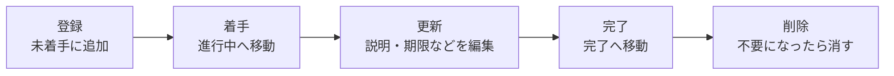

# 機能仕様書：タスク管理アプリ（カンバンボード）

[要件定義書](requirements.md) の「4. 機能要件」と「3. 利用シナリオ」を詳しくした資料です。
画面の見た目や細かい動きは [画面設計書](screens.md) を参照してください。

---

## 1. 機能一覧

### F1 ログイン

- パスワードを入力して使い始める。パスワードは1つだけで、開発者がサーバーの設定で管理する
- ログインしていないと、ボードを見ることも変更することもできない
- 一度ログインすると、同じ端末・ブラウザでは30日間ログインしたままになる
- ボード画面の「ログアウト」で、いつでもログアウトできる

### F2 ボード表示

- カンバンボード形式で画面を表示する
- 次の3つの列を、この順で固定で表示する
  - 未着手
  - 進行中
  - 完了
- 各列の見出しに、その列のタスクの件数を表示する
- カードには、タイトルと優先度を表示する。期限は設定されているときだけ表示する

### F3 タスクの登録

- 各列の一番下にある入力欄にタイトルを入力し、Enter キー（または「追加」ボタン）で、その列の一番下にタスクを登録する
- 登録したあとも入力欄にカーソルが残り、続けて登録できる
- タスクは次の情報を持つ

| 項目 | 必須 | 登録したときの値 |
|---|---|---|
| タイトル | 必須 | 入力したタイトル |
| 説明 | 任意 | 空 |
| 優先度（高・中・低） | 必須 | 中 |
| 期限（日付） | 任意 | なし |

- 入力のルール（空のタイトル、文字数、過去の日付など）は [画面設計書](screens.md#3-入力のルール) を参照

### F4 タスクの編集

- カードをクリック（スマホはタップ）すると詳細画面が開く
- 詳細画面で、タイトル・説明・優先度・期限を編集できる
- 編集した内容は自動で保存する（保存ボタンはない）

### F5 タスクの削除

- カードの「×」ボタンで、確認なしで削除する
- 詳細画面の「削除」ボタンでは、「『タイトル』を削除しますか？」と確認してから削除する

### F6 タスクの移動

- PC：カードをドラッグ＆ドロップして、別の列の好きな位置へ移す
- スマホ：詳細画面の「ステータス」で移動先の列のボタンを押すと、その列の一番下へ移る

### F7 手動の並べ替え

- PC：同じ列の中でカードをドラッグ＆ドロップして、順番を入れ替える
- スマホ：詳細画面の「上へ」「下へ」で、同じ列の隣のカードと順番を入れ替える

### F8 自動の並べ替え

- ボード画面の右上で並べ方を選び、「並べ替え」ボタンを押すと、全部の列をそれぞれ並べ替える
- 並べ方は次の3つ

| 並べ方 | 並ぶ順番 |
|---|---|
| 優先度順 | 優先度が高い順。同じ優先度なら期限が近い順（期限なしは後ろ） |
| 期限順 | 期限が近い順。期限なしは最後。同じ期限なら優先度が高い順 |
| 登録順 | 登録した順 |

- 並べ替えた順番は保存する。並べ替えたあとも、F7 で手動で調整できる
- 並べ方を選んだだけでは並べ替えない（ボタンを押したときだけ並べ替える）

### F9 データの保存

- データはサーバーのデータベースに保存する
- ブラウザを閉じても、端末を替えても、同じ内容が表示される
- 別の端末で変更した内容は、ページを開き直すと反映される（開いている画面に自動では反映しない）

### F10 スマートフォン対応

- 画面幅が 721px 以上なら列を横に3つ並べ、720px 以下なら縦に並べる
- スマホでもすべての機能を使える。ドラッグ＆ドロップの代わりに、詳細画面の操作を使う

### F11 背景写真

- 海外の有名な建築物の写真を背景に表示する
- 写真は数枚用意し、ページを開くたびにランダムで切り替える
- 写真の上でも文字が読めるよう、列とヘッダーは半透明にする
- 撮影者名とライセンスを画面右下に表示する。クリックすると写真の出典ページを開く
- 写真が読み込めないときは、写真なしで表示する

---

## 2. 利用シナリオ

### 2.1 タスクの基本の流れ

### 2.2 シナリオ一覧

| No. | シナリオ | PC での操作 | スマホでの操作 | 使う機能 |
|---|---|---|---|---|
| UC0 | 使い始める | URL を開き、パスワードを入力してログインする | 同じ | F1 |
| UC1 | 思いついたタスクを登録する | 「未着手」の入力欄にタイトルを入力して Enter キー | 入力欄にタイトルを入力して「追加」 | F3 |
| UC2 | タスクに詳しい情報を足す | カードをクリックし、詳細画面で説明・優先度・期限を入力する | カードをタップして同じ | F4 |
| UC3 | 作業を始める・終える | カードを「進行中」「完了」の列へドラッグ＆ドロップする | カードをタップし、詳細画面の「ステータス」で移動先の列を選ぶ | F6 |
| UC4 | 何から手をつけるか決める | 優先度順か期限順を選んで「並べ替え」を押す。必要ならドラッグで調整する | 「並べ替え」を押し、必要なら「上へ」「下へ」で調整する | F7・F8 |
| UC5 | 終わったタスクを片付ける | カードの「×」、または詳細画面の「削除」で消す | 同じ | F5 |

### 2.3 1日の使い方の例

1. 朝、会社の PC でボードを開き（UC0）、今日やることを「未着手」に登録する（UC1）
2. 優先度と期限を入れ（UC2）、優先度順に並べ替えて、最初にやることを決める（UC4）
3. 取りかかったタスクを「進行中」に移す（UC3）
4. 外出先ではスマホで同じボードを開き、終わったタスクを「完了」に移す（UC3）
5. たまった完了タスクは、週に1回ほどまとめて削除する（UC5）

---

## 3. 今後の追加候補

今回は作りませんが、今後追加を検討する機能です。

- 優先度ごとにカードの色を分ける
- 期限を過ぎたタスクの期限を赤く表示する
- 複数人での利用（ユーザーごとにボードを分ける）
