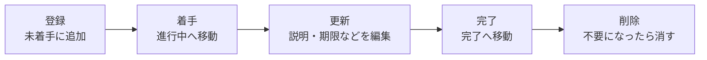
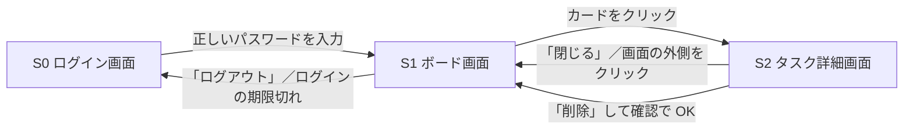
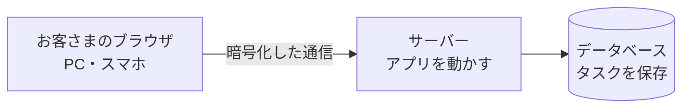
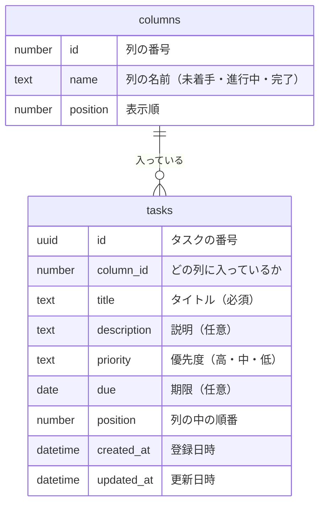
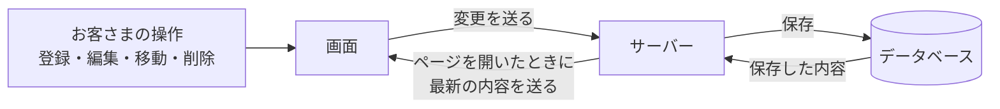

# 要件定義書：タスク管理アプリ（カンバンボード）

| 項目 | 内容 |
|---|---|
| 文書番号 | REQ-001 |
| 版数 | 1.0 |
| 作成日 | 2026-11-15 |
| 提出先 | 【クライアント名】様 |
| 作成者 | 【作成者名】 |
| 状態 | ご確認依頼中 |

### 改訂履歴

| 版数 | 日付 | 内容 | 作成者 |
|---|---|---|---|
| 1.0 | 2026-11-15 | 初版 | 【作成者名】 |

---

## 1. はじめに

### 1.1 この文書の目的

この文書は、【クライアント名】様（以下「お客さま」）からご依頼いただいたタスク管理アプリについて、**作るもの・作らないもの・完成の基準**をお客さまと開発者の間で合意するためのものです。
内容をご確認いただき、「13. 未決事項」にお答えいただいたうえで、問題がなければ「14. 承認」にご記入ください。ご確認いただいた内容をもとに設計・開発に進みます。

### 1.2 用語の説明

| 用語 | 意味 |
|---|---|
| タスク | やるべきこと1件。アプリの画面では「カード」として表示する |
| カラム（列） | タスクの状態を表す縦の列。「未着手」「進行中」「完了」の3つ |
| カンバンボード | カラムを横に並べ、タスクのカードを列から列へ動かして状態を管理する画面の形式 |
| ドラッグ＆ドロップ | マウスでカードをつかんで、別の場所に動かして離す操作 |
| ログイン | パスワードを入力して、アプリを使える状態にすること |
| サーバー | インターネット上でアプリを動かし、データを保存しておくコンピューター |
| データベース | タスクのデータを整理して保存しておく仕組み |
| 無料プラン | サーバーやデータベースを提供する会社の、費用がかからない利用プラン。性能や稼働に制限がある |

---

## 2. プロジェクト概要

### 2.1 背景（お客さまの現状と課題）

- お客さまは、日々のやることをメモや頭の中で管理している
- そのため、次のことに困っている
  - やることを忘れてしまうことがある
  - 何が終わっていて、何が残っているのかをすぐに把握できない
  - たくさんあるやることの中から、何から手をつければよいか判断しにくい
- 会社の PC と外出先のスマートフォンの両方から、同じ内容を確認したい

### 2.2 目的

やることを「未着手」「進行中」「完了」の3つの状態に分けて画面に並べ、**状態をひと目で把握できるようにする**。

### 2.3 導入によって期待する効果

| 今の課題 | 導入後 |
|---|---|
| やることを忘れる | 思いついたときにすぐ登録でき、一覧で見返せる |
| 進み具合が分からない | 列ごとの件数と並びで、残っているものと終わったものがすぐ分かる |
| 何から手をつけるか迷う | 優先度順・期限順に並べ替えて、最初にやることを決められる |
| PC とスマホで内容が別々 | どちらからでも同じ内容を見て、更新できる |

### 2.4 利用者

- お客さま1名
- ほかの人との共有や、複数人での利用は行わない

### 2.5 利用環境

- インターネットにつながった PC・タブレット・スマートフォンの Web ブラウザ
- アプリのインストールは不要。決まった URL をブラウザで開いて使う

---

## 3. 利用シナリオ

### 3.1 タスクの基本の流れ



### 3.2 シナリオ一覧

| No. | シナリオ | PC での操作 | スマホでの操作 |
|---|---|---|---|
| UC0 | 使い始める | URL を開き、パスワードを入力してログインする（一度ログインすれば、30日間は入力不要） | 同じ |
| UC1 | 思いついたタスクを登録する | 「未着手」の入力欄にタイトルを入力して Enter キー | 入力欄にタイトルを入力して「追加」 |
| UC2 | タスクに詳しい情報を足す | カードをクリックし、詳細画面で説明・優先度・期限を入力する | カードをタップして同じ |
| UC3 | 作業を始める・終える | カードを「進行中」「完了」の列へドラッグ＆ドロップする | カードをタップし、詳細画面で移動先の列を選ぶ |
| UC4 | 何から手をつけるか決める | 優先度順か期限順を選んで「並べ替え」を押す。必要ならドラッグで順番を調整する | 「並べ替え」を押し、必要なら詳細画面の「上へ」「下へ」で調整する |
| UC5 | 終わったタスクを片付ける | カードの「×」、または詳細画面の「削除」で消す | 同じ |

### 3.3 1日の使い方の例

1. 朝、会社の PC でボードを開き、今日やることを「未着手」に登録する
2. 優先度と期限を入れ、優先度順に並べ替えて、最初にやることを決める
3. 取りかかったタスクを「進行中」に移す
4. 外出先ではスマホで同じボードを開き、終わったタスクを「完了」に移す
5. たまった完了タスクは、週に1回ほどまとめて削除する

---

## 4. 機能要件

| No. | 機能 | 内容 |
|---|---|---|
| F1 | ログイン | パスワードを入力して使い始める。ログインしていないと、ボードを見ることも変更することもできない。一度ログインすると、同じ端末・ブラウザでは30日間ログインしたままになる。ログアウトもできる |
| F2 | ボード表示 | 「未着手」「進行中」「完了」の3つの列を表示し、各列の見出しにタスクの件数を表示する |
| F3 | タスクの登録 | 各列の入力欄にタイトルを入力して、その列にタスクを登録する。タスクは、タイトル（必須）、説明（任意）、優先度（高・中・低）、期限（日付、任意）を持つ |
| F4 | タスクの編集 | カードをクリックすると詳細画面が開き、各項目を編集できる。編集した内容は自動で保存する（保存ボタンはない） |
| F5 | タスクの削除 | カードの「×」で削除する。詳細画面から削除するときは、確認のメッセージを表示する |
| F6 | タスクの移動 | PC はドラッグ＆ドロップで、スマホは詳細画面で移動先の列を選んで、別の列に移動する |
| F7 | 手動の並べ替え | PC は同じ列の中でドラッグ＆ドロップして、スマホは詳細画面の「上へ」「下へ」で、順番を入れ替える |
| F8 | 自動の並べ替え | ボタンを押すと、全部の列を次のどれかの順に並べ替える。並べ替えた順番は保存され、そのあと手動でも調整できる<br>・優先度順（同じ優先度なら期限が近い順）<br>・期限順（期限なしは最後。同じ期限なら優先度が高い順）<br>・登録順 |
| F9 | データの保存 | データはサーバーに保存する。ブラウザを閉じても、端末を替えても、同じ内容が表示される。別の端末で変更した内容は、ページを開き直すと反映される |
| F10 | スマートフォン対応 | 画面幅が狭いときは列を縦に並べる。スマホでもすべての機能を使える |
| F11 | 背景写真 | 海外の有名な建築物の写真を背景に表示し、開くたびに切り替える。写真の上でも文字が読めるよう、列は半透明にする。写真の撮影者とライセンスを画面右下に表示する |

---

## 5. 非機能要件

### 5.1 対応する端末とブラウザ

| 区分 | OS | ブラウザ |
|---|---|---|
| PC | Windows | Google Chrome、Microsoft Edge |
| PC | macOS | Safari、Google Chrome |
| タブレット | iPadOS | Safari |
| スマホ | iOS | Safari |
| スマホ | Android | Google Chrome |

- いずれも、納品時点の最新版を対象とする

### 5.2 表示

- スマホ（画面幅 360px）から大きなパソコン画面（1920px）まで、横にスクロールせずに表示できる
- 端末が暗い配色の設定（ダークモード）のときは、暗い配色で表示する

### 5.3 速さ

- タスクが100件あっても、登録・移動・編集の結果がすぐ画面に反映される
- 普段は、ページを開いてから2秒以内にボードを表示する
- **ただし、15分以上だれも使っていなかったときは、サーバーが休止しているため、表示まで1分ほどかかる**（「8. 前提条件・了承事項」を参照）。その間は「起動しています」と表示する

### 5.4 使いやすさ

- タスクの登録は、タイトルを入力して Enter キーを押すだけでできる
- 初めて使う人でも、説明を読まずに登録・移動・編集ができる
- キーボードだけでもすべての機能を使える（ドラッグ＆ドロップの代わりに、詳細画面の「列」と「上へ」「下へ」を使う）

### 5.5 アクセシビリティ（だれでも使いやすくするための配慮）

- 文字と背景の色の差を十分にとり、見やすくする（国際的な基準 WCAG 2.1 の AA を目安にする）
- 優先度などを色だけで区別せず、「優先度: 高」のように文字でも表示する
- スクリーンリーダー（画面の読み上げソフト）への対応は最低限とする。記号だけのボタン（「×」など）に読み上げ用の名前を付けるが、読み上げソフトでの動作確認は行わない

### 5.6 安全性

- パスワードを知らない人は、タスクを見ることも変更することもできない
- 通信はすべて暗号化する（URL が `https://` で始まる）
- 入力した文字は文字として表示し、プログラムとして動かないようにする

---

## 6. 画面構成

### 6.1 画面一覧

| No. | 画面名 | 内容 |
|---|---|---|
| S0 | ログイン画面 | パスワードを入力する |
| S1 | ボード画面 | 3つの列とタスクを表示する。登録・移動・並べ替え・ログアウトを行う |
| S2 | タスク詳細画面 | ボード画面の上に重ねて表示する。編集・削除・列の移動・上下の並べ替えを行う |

### 6.2 画面の移り変わり



### 6.3 画面イメージ

#### S0 ログイン画面

```text
┌──────────────────────────────┐
│ ボード                       │
│                              │
│ パスワード                   │
│ [••••••••                  ] │
│                    [ログイン]│
└──────────────────────────────┘
```

#### S1 ボード画面（PC）

```text
┌───────────────────────────────────────────────────────────┐
│ ボード             [優先度順 ▼] [並べ替え] [ログアウト]   │
├───────────────────────────────────────────────────────────┤
│ ┌ 未着手      2 ┐  ┌ 進行中      1 ┐  ┌ 完了        0 ┐   │
│ │┌────────────┐│  │┌────────────┐│  │               │   │
│ ││資料を作る ×││  ││買い物     ×││  │               │   │
│ ││優先度:高   ││  ││優先度:中   ││  │               │   │
│ ││期限:11/20  ││  │└────────────┘│  │               │   │
│ │└────────────┘│  │               │  │               │   │
│ │[カードを追加…][追加]│[カードを追加…][追加]│[カードを追加…][追加]│
│ └──────────────┘  └──────────────┘  └──────────────┘   │
│                                  写真: 撮影者 / ライセンス │
└───────────────────────────────────────────────────────────┘
```

#### S1 ボード画面（スマホ）

```text
┌─────────────────────┐
│ ボード              │
│ [優先度順 ▼][並べ替え]│
│ [ログアウト]        │
├─────────────────────┤
│ ┌ 未着手        2 ┐ │
│ │ [資料を作る   ×] │ │
│ │ [カードを追加…][追加]│
│ └─────────────────┘ │
│ ┌ 進行中        1 ┐ │
│ │ [買い物       ×] │ │
│ └─────────────────┘ │
│ ┌ 完了          0 ┐ │
│ └─────────────────┘ │
└─────────────────────┘
```

#### S2 タスク詳細画面

```text
┌──────────────────────────────┐
│ カードの詳細                 │
│ タイトル  [資料を作る      ] │
│ 説明      [                ] │
│ 優先度 [高 ▼]  期限 [11/20]  │
│ 列 [未着手 ▼]   [上へ][下へ] │
│ [削除]                [閉じる]│
└──────────────────────────────┘
```

### 6.4 うまくいかなかったときの表示

| 場面 | 画面の表示 |
|---|---|
| パスワードが違う | ログイン画面に「パスワードが違います」と表示する |
| タイトルを入れずに追加しようとした | 何も追加しない |
| サーバーが休止から起動している | 「サーバーを起動しています。1分ほどかかることがあります」と表示する |
| 通信できず、保存できなかった | 画面の上に「保存できませんでした。通信状況を確認してください」と表示し、保存されている内容を表示し直す |
| ボードを読み込めなかった | 「読み込めませんでした」と表示し、「再読み込み」ボタンを出す |
| ログインの期限（30日）が切れた | ログイン画面に戻る |

- 細かい動き（メッセージの表示位置や消えるまでの時間など）は、設計書で決めます

---

## 7. 対象外（今回は作らないもの）

- 複数人での利用、ほかの人との共有、担当者の設定
- パスワードを忘れたときに画面から再設定する機能（開発者に依頼して変更する）
- 別の端末での変更を、開いている画面に自動で反映すること
- 列の追加・削除・名前の変更
- インターネットにつながっていないときの利用
- スマホでのドラッグ＆ドロップ（詳細画面の操作で代わりにする）
- データの定期的なバックアップ
- 優先度ごとのカードの色分け、期限切れの強調表示（今後の追加候補）

---

## 8. 前提条件・了承事項

費用を抑えるため、サーバーとデータベースは無料プランを使います。そのため、次の点をご了承ください。

| No. | 内容 |
|---|---|
| P1 | **表示の遅れ**：15分以上使っていないとサーバーが休止します。次に開くときは、表示まで1分ほどかかります |
| P2 | **稼働の保証なし**：提供会社の都合でサービスが止まることがあり、その間は使えません。稼働時間の保証はできません |
| P3 | **データのバックアップなし**：提供会社の障害などでデータが失われた場合、元に戻せないことがあります |
| P4 | **利用条件の変更**：無料プランの条件は提供会社によって変わることがあります。条件が変わり使えなくなった場合は、有料プランへの切り替えなどをご相談します |
| P5 | **インターネット接続**：使うときは常にインターネット接続が必要です |
| P6 | **背景写真**：利用が許可された写真だけを使い、ライセンスが求める撮影者名などを画面に表示します |

---

## 9. システム構成の概要



- 画面、サーバー、データベースはすべてインターネット上のサービスで動かすため、お客さまの端末に何かを入れる必要はありません

### 9.1 扱うデータ

#### データの構成（ER図）

データベースには「列」と「タスク」の2種類のデータを保存します。1つの列には複数のタスクが入り、1つのタスクは必ずどれか1つの列に入ります。



- `columns` は「列」、`tasks` は「タスク」のデータです。名前はプログラムの中で使う英語の名前で、右側に意味を書いています

#### データの流れ



- 操作すると、画面がすぐに切り替わり、同時にサーバーを通してデータベースに保存されます
- ページを開いたときは、データベースから最新の内容を読み込んで表示します。そのため、PC で変更した内容をスマホでも見られます
- 保存しているのは上の表の項目だけです。お客さまの名前やメールアドレスなどの個人情報は保存しません

### 9.2 使う技術

| 区分 | 使うもの | 選んだ理由 |
|---|---|---|
| 画面 | HTML / CSS / JavaScript | Web ブラウザの標準の技術で、特別な道具（フレームワークやビルドツール）を使わない。将来ほかの開発者に引き継ぐときも、Web 開発の基本が分かる人なら読める |
| サーバー | Node.js、Express | 画面と同じ JavaScript という言語で書けるため、扱う言語が1つで済む。利用者が多く、資料や引き継げる開発者を見つけやすい |
| データベース | PostgreSQL | 世界中で広く使われている無料のデータベース。将来、別のサービスへの引っ越しや有料プランへの切り替えもしやすい |
| サーバーの置き場所 | Render（無料プラン） | 費用がかからない。プログラムを更新すると自動で反映される |
| データベースの置き場所 | Neon（無料プラン） | 費用がかからず、期限なしで使える |
| ソースコードの管理 | GitHub | 変更の履歴がすべて残る。引き継ぐときは、このリポジトリを渡せばよい |

- 使うライブラリ（部品）は、Web サーバーの Express と、データベースにつなぐ node-postgres の2つだけに絞り、更新や保守の手間を減らす

---

## 10. 納品物

| No. | 納品物 | 内容 |
|---|---|---|
| D1 | アプリ | 公開 URL で使える状態にしたアプリ |
| D2 | ソースコード | GitHub のリポジトリ |
| D3 | 要件定義書 | この文書 |
| D4 | 設計書 | 画面・データ・システムの設計 |
| D5 | 操作説明書 | ログインから削除までの使い方 |
| D6 | テスト結果報告書 | 「12. 受け入れ基準」の確認結果 |

---

## 11. スケジュール

| No. | 工程 | 内容 | 目安の期間 | 終わる日 |
|---|---|---|---|---|
| 1 | 要件定義 | この文書の作成とご承認 | 1週間 | 【日付】 |
| 2 | 設計 | 画面・データ・システムの設計 | 1週間 | 【日付】 |
| 3 | 開発 | アプリの作成 | 2週間 | 【日付】 |
| 4 | テスト | 開発者による動作確認 | 1週間 | 【日付】 |
| 5 | 受け入れ確認 | お客さまによる確認（「12. 受け入れ基準」） | 1週間 | 【日付】 |
| 6 | 納品 | 納品物のお渡し | — | 【日付】 |

- 日付は、この文書のご承認後に決めて記入します

---

## 12. 受け入れ基準

「5.1 対応する端末とブラウザ」のうち、PC（Windows の Chrome）とスマホ（iPhone の Safari）で、次のすべてが確認できたら完成とします。

| No. | 確認すること | 期待する結果 |
|---|---|---|
| T1 | 正しいパスワードでログインする | ボード画面が表示される |
| T2 | 間違ったパスワードでログインする | 「パスワードが違います」と表示され、ボードは表示されない |
| T3 | 「未着手」にタイトルを入力して Enter（スマホは「追加」） | 「未着手」の一番下にカードが追加され、件数が1増える |
| T4 | タイトルを空のまま追加する | カードは追加されない |
| T5 | カードを開いて説明・優先度・期限を変え、閉じる | カードに優先度と期限が表示される。開き直すと説明も変わっている |
| T6 | PC でカードを「進行中」へドラッグ＆ドロップする | カードが「進行中」の落とした位置に移り、両方の列の件数が変わる |
| T7 | スマホで詳細画面の列を「完了」に変える | カードが「完了」の一番下に移る |
| T8 | 「上へ」「下へ」を押す | 同じ列の中で順番が1つ入れ替わる |
| T9 | 優先度順・期限順・登録順でそれぞれ並べ替える | 「4. 機能要件 F8」の順に並ぶ |
| T10 | カードの「×」で削除する | カードが消え、件数が1減る |
| T11 | 詳細画面の「削除」を押す | 確認メッセージが出て、OK なら消え、キャンセルなら残る |
| T12 | PC で変更したあと、スマホでページを開く | PC で変更した内容が表示される |
| T13 | ブラウザを閉じて開き直す | ログインしたまま、前回の内容が表示される |
| T14 | 「ログアウト」を押す | ログイン画面に戻り、パスワードを入れるまでボードは表示されない |
| T15 | タイトルに `<b>太字</b>` と入力して登録する | 文字のまま表示され、太字にはならない |

---

## 13. 未決事項

ご承認の前に、次の点についてお考えをお聞かせください。

| No. | 内容 | 開発者からの案 |
|---|---|---|
| Q1 | ログインしたままにする期間 | 30日 |
| Q2 | ページを開いてから表示されるまでの目安 | 2秒以内（休止中を除く） |
| Q3 | 納品後の不具合の対応（期間と範囲） | 【別途ご相談】 |
| Q4 | 開発費用 | 別途お見積りします。サーバーとデータベースの利用料は無料プランのため0円 |

---

## 14. 承認

上記の内容で合意します。

| 立場 | 氏名 | 日付 | 署名 |
|---|---|---|---|
| お客さま | | | |
| 開発者 | | | |
