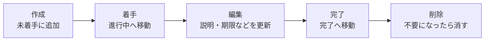
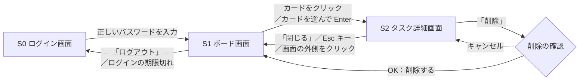

# 要件定義書: タスク管理アプリ（Trello風）

## 1. プロジェクト概要

### 1.1 目的

このプロジェクトには、次の2つの目的がある。

1. **学習**：スクールの課題として、要件定義・設計・実装・公開という開発の流れを一通り自分で経験する。画面だけでなく、バックエンドと DB を作って運用するところまで行う。仕組みを理解しながら作れるよう、SQL を自分で書くなど、中身が見える作り方を選ぶ（[技術スタック選定書](tech-stack.md)）。
2. **実用**：自分のタスクを Trello 風のカンバンボードで管理し、状態をひと目で分かるようにする。完成後は実際に自分で使う。

### 1.2 背景

- スクールの課題で、Web アプリを1つ企画してから公開するまでを経験することになった
- 題材には、自分が普段困っていることを解決するものを選んだ
  - やることを忘れがちで、何が終わっていて何が残っているのかを把握しきれていない
  - タスクを見える化し、何から手をつけるかを判断しやすくしたい

### 1.3 利用者

- 個人利用（1人）
- 他の人に見られないよう、パスワードでログインしてから使う
- 他の人との共有や、複数ユーザーでの利用は行わない

### 1.4 利用環境

- Web ブラウザ（PC・タブレット・スマートフォン）
- データはサーバーの DB に保存し、PC とスマホのどちらからでも同じデータを見られる

---

## 2. 利用シナリオ

### 2.1 基本の流れ

1つのタスクは、次の順でボードの上を移っていく。



### 2.2 シナリオ一覧

| No. | シナリオ | PC での操作 | スマホでの操作 |
|---|---|---|---|
| UC0 | ボードを使い始める | 公開 URL を開き、パスワードを入力してログイン（一度ログインすれば、しばらくは入力不要） | 同じ |
| UC1 | 思いついたタスクを登録する | 「未着手」の入力欄にタイトルを入力して Enter（または「追加」） | 同じ（キーボードの改行キーまたは「追加」） |
| UC2 | タスクに詳しい情報を足す | カードをクリック → 詳細画面で説明文・優先度・期限を入力 → 「閉じる」 | カードをタップ → 同じ |
| UC3 | 作業を始める・終える | カードを「進行中」「完了」の列へドラッグ＆ドロップ | カードをタップ → 詳細画面の「列」で移動先を選ぶ |
| UC4 | 何から手をつけるか決める | 「並べ方」で優先度順か期限順を選んで「並べ替え」 → 必要ならドラッグで微調整 | 「並べ替え」 → 必要なら詳細画面の「上へ」「下へ」で微調整 |
| UC5 | 終わったタスクを片付ける | カードの「×」で削除（確認なし）、または詳細画面の「削除」（確認あり） | 同じ |

### 2.3 1日の使い方の例

1. 朝、PC でボードを開き（UC0）、今日やることを「未着手」に追加する（UC1）
2. 優先度と期限を設定し（UC2）、優先度順に並べ替えて最初に手をつけるタスクを決める（UC4）
3. 取りかかったタスクを「進行中」に移す（UC3）
4. 外出先ではスマホで同じボードを開き、終わったタスクを「完了」に移す（UC3）
5. たまった完了タスクは週に1回ほど削除する（UC5）

---

## 3. 機能要件

### 3.1 ボード表示機能

- カンバンボード形式で画面を表示する
- 以下の3つのカラム（列）を固定で表示する
  - 未着手
  - 進行中
  - 完了
- 各カラムの見出しに、タスクの件数を表示する

### 3.2 タスク管理機能

#### 3.2.1 タスクの作成

- 各カラムの入力欄にタイトルを入力して、そのカラムにタスクを作成できる
- タスクは以下の情報を持つ
  - タイトル（必須）
  - 説明文（任意）
  - 優先度（高・中・低）
  - 期限（日付、任意）
- 入力の細かいルール（文字数の上限、過去の日付を期限にできるかなど）は [基本設計書](basic-design.md) で決める

#### 3.2.2 タスクの編集

- タスクをクリックすると詳細画面が開く
- 詳細画面で、作成済みのタスクの各項目を編集できる
- 編集した内容はその場で保存される

#### 3.2.3 タスクの削除

- 不要なタスクを削除できる
- 詳細画面から削除するときは、確認のメッセージを表示する

#### 3.2.4 タスクの移動

- PC：ドラッグ＆ドロップでタスクを別のカラムに移動できる
- スマホ：詳細画面で移動先のカラムを選んで移動できる

#### 3.2.5 タスクの並び替え

- 手動の並び替え
  - PC：同一カラム内でタスクをドラッグ＆ドロップして並び替えできる
  - スマホ：詳細画面の「上へ」「下へ」ボタンで並び替えできる
- 自動の並び替え
  - ボタンを押すと、全カラムのタスクを以下の順に並び替えできる
    - 優先度順（同じ優先度なら期限が近い順）
    - 期限順（期限なしは最後。同じ期限なら優先度が高い順）
    - 作成順
  - 並び替えた順番は保存され、その後も手動で並び替えできる

### 3.3 データ保存機能

- タスクのデータをサーバーの DB に保存する
- タブやブラウザを閉じても、端末を替えても、データが残る
- 別の端末で変更した内容は、ページを開き直すと反映される（リアルタイムの自動反映は行わない）

### 3.4 ログイン機能

- パスワードを入力してログインする。パスワードは1つだけで、サーバーの設定で管理する
- ログインしていないと、ボードの表示やタスクの読み書きはできない
- 一度ログインすると、30日間は同じ端末・ブラウザでログインしたままにする
- ログアウトできる

### 3.5 スマートフォン対応

- 画面幅が狭いときは、カラムを縦に並べて表示する
- スマホでもすべての機能を操作できる

### 3.6 背景写真

- 海外の景色や有名な建築物の写真を背景に表示する
- 写真は数枚用意し、ページを開くたびにランダムで切り替える
- 写真の上でも文字が読めるよう、カラムとヘッダーは半透明にする
- 撮影者名・ライセンスのクレジットを画面右下に表示する
- 写真がない場合や読み込めない場合は、写真なしで表示する

### 3.7 今後の追加候補

- 優先度ごとにタスクの色を分ける
- 期限を過ぎたタスクの期限を赤く表示する

---

## 4. 非機能要件

### 4.1 対応ブラウザ・端末

| 区分 | OS | ブラウザ |
|---|---|---|
| PC | Windows | Google Chrome、Microsoft Edge |
| PC | macOS | Safari、Google Chrome |
| タブレット | iPadOS | Safari |
| スマホ | iOS | Safari |
| スマホ | Android | Google Chrome |

- 各ブラウザとも、動作確認をする時点の最新版を対象とする（古い版は対象外）
- 動作確認をしたときは、確認した端末・OS・ブラウザの版を記録しておく
- 上の表にないブラウザ（Firefox など）は、動けばよいものとし、確認は必須にしない

### 4.2 表示・画面サイズ

- 画面幅 360px（スマホ）から 1920px（PC）まで、横スクロールなしで表示できる
- 画面幅が 721px 以上ならカラムを横に3列、720px 以下なら縦に1列で表示する
- ボードの横幅は最大 1100px とし、それより広い画面では中央に寄せる
- OS がダークモードのときは、暗い配色で表示する

### 4.3 性能

- タスクが 100 件あっても、追加・移動・編集・並べ替えの結果が、待たされていると感じずに画面に反映される（目安 0.1 秒以内）
- 想定するタスク数の上限は 1,000 件とする
- サーバーが動いているときは、ページを開いてからボードが表示されるまで 2 秒以内を目安とする。背景写真は後から表示されてよい
- サーバーが停止しているとき（15分以上アクセスがなかったとき）は、起動に1分ほどかかることを認める。その間は読み込み中であることが分かるようにする
- 背景写真は1枚 500KB 以下にして、スマホの通信量を抑える

### 4.4 使いやすさ

- タスクの作成は、タイトルを入力して Enter キーを押すだけでできる
- 作成したあとも同じ入力欄にカーソルが残り、続けて入力できる
- 初めて使う人でも、説明を読まずに作成・移動・編集ができる
- スマホでは、ボタンや入力欄を指で押しやすい大きさにする

### 4.5 アクセシビリティ

- キーボードだけで、すべての機能を操作できる
  - Tab キーでカードや入力欄、ボタンを順に選べる
  - 選んだカードで Enter キーを押すと詳細画面が開き、Esc キーで閉じる
  - ドラッグ＆ドロップはキーボードではできないため、詳細画面の「列」と「上へ」「下へ」で代わりに操作する
- スクリーンリーダー対応は最低限とする
  - 文字のないボタン（「×」）や見出しのない入力欄には、読み上げ用の名前を付ける
  - 読み上げソフトでの動作確認は必須にしない
- 文字と背景の色の差は、WCAG 2.1 の AA（コントラスト比 4.5:1 以上）を目安にする
- 優先度などの情報を、色だけで区別しない（「優先度: 高」のように文字でも表示する）

### 4.6 安全性

- 入力された文字はそのまま文字として表示し、HTML やスクリプトとして実行されないようにする
- 通信はすべて HTTPS で暗号化する
- ログインしていない人は、タスクを読むことも書くこともできない
- パスワードや DB の接続情報は、ソースコードや GitHub に置かず、サーバーの環境変数で管理する
- DB への命令（SQL）にユーザーの入力をそのまま埋め込まない（SQL インジェクション対策）

### 4.7 可用性

- サーバー（Render）と DB（Neon）は無料プランで、稼働は保証されていないため、止まっている間は使えなくてもよい
- 使うときは常にインターネット接続が必要。オフラインでの利用には対応しない

### 4.8 保守性

- 処理の意図を日本語のコメントで残す
- 画面のコード、サーバーのコード、DB のテーブル定義（SQL）をフォルダで分ける
- DB のテーブル定義は SQL ファイルで管理し、同じ手順で作り直せるようにする

---

## 5. 画面構成

### 5.1 画面一覧

| No. | 画面名 | 概要 |
|---|---|---|
| S0 | ログイン画面 | パスワードを入力してログインする。ログインしていないときに表示する |
| S1 | ボード画面 | 3つのカラムとタスクを表示する。タスクの作成、ドラッグ＆ドロップでの移動、自動の並び替えを行う |
| S2 | タスク詳細画面 | ボード画面の上に重ねて表示する。タスクの各項目の編集、削除、カラムの移動、上下の並び替えを行う |
| — | 削除の確認 | 詳細画面で「削除」を押したときに出す確認メッセージ（ブラウザ標準の確認ダイアログ） |

### 5.2 画面遷移図



### 5.3 ワイヤーフレーム

#### S0 ログイン画面

```text
┌──────────────────────────────┐
│ ボード                       │
│                              │
│ パスワード                   │
│ [••••••••                  ] │
│                    [ログイン]│
│                              │
│ ※ 間違えたときは「パスワードが │
│   違います」と表示する       │
└──────────────────────────────┘
```

#### S1 ボード画面（PC：画面幅 721px 以上）

```text
┌───────────────────────────────────────────────────────────┐
│ ボード             [優先度順 ▼] [並べ替え] [ログアウト]   │ ← ヘッダー
├───────────────────────────────────────────────────────────┤
│ ┌ 未着手      2 ┐  ┌ 進行中      1 ┐  ┌ 完了        0 ┐   │ ← 見出しと件数
│ │┌────────────┐│  │┌────────────┐│  │               │   │
│ ││資料を作る ×││  ││買い物     ×││  │               │   │ ← カード
│ ││優先度:高   ││  ││優先度:中   ││  │               │   │
│ ││期限:11/20  ││  │└────────────┘│  │               │   │
│ │└────────────┘│  │               │  │               │   │
│ │┌────────────┐│  │               │  │               │   │
│ ││本を返す   ×││  │               │  │               │   │
│ ││優先度:低   ││  │               │  │               │   │
│ │└────────────┘│  │               │  │               │   │
│ │[カードを追加…][追加]│[カードを追加…][追加]│[カードを追加…][追加]│ ← 入力欄
│ └──────────────┘  └──────────────┘  └──────────────┘   │
│                                  写真: 撮影者 / ライセンス │ ← クレジット
└───────────────────────────────────────────────────────────┘
```

#### S1 ボード画面（スマホ：画面幅 720px 以下）

```text
┌─────────────────────┐
│ ボード              │
│ [優先度順 ▼][並べ替え]│
│ [ログアウト]        │
├─────────────────────┤
│ ┌ 未着手        2 ┐ │
│ │ [資料を作る   ×] │ │
│ │ [本を返す     ×] │ │
│ │ [カードを追加…][追加]│
│ └─────────────────┘ │
│ ┌ 進行中        1 ┐ │
│ │ [買い物       ×] │ │
│ │ [カードを追加…][追加]│
│ └─────────────────┘ │
│ ┌ 完了          0 ┐ │
│ │ [カードを追加…][追加]│
│ └─────────────────┘ │
└─────────────────────┘
```

#### S2 タスク詳細画面

```text
┌──────────────────────────────┐
│ カードの詳細                 │
│ タイトル                     │
│ [資料を作る                ] │
│ 説明文                       │
│ [                          ] │
│ [                          ] │
│ 優先度          期限         │
│ [高 ▼]          [2026/11/20] │
│ 列              [上へ][下へ] │
│ [未着手 ▼]                   │
│ [削除]                [閉じる]│
└──────────────────────────────┘
  ※ 後ろのボード画面は暗く表示する
```

### 5.4 画面の細かい動き

画面の各部分の動きや、入力ミス・エラーのときの表示は、[基本設計書](basic-design.md) にまとめる。

---

## 6. 対象外（今回は作らない）

- 複数ユーザーでの利用、他の人との共有、担当者の設定
- パスワードを忘れたときの再設定画面（サーバーの設定で変更する）
- 別の端末での変更を、開いている画面に自動で反映すること
- カラムの追加・削除・名前変更
- オフラインでの利用
- スマホでのドラッグ＆ドロップ（詳細画面の操作で代わりにする）
- DB の定期的なバックアップ

---

## 7. 技術構成

| 区分 | 採用 |
|---|---|
| 画面 | HTML / CSS / JavaScript（フレームワークなし） |
| サーバー | Node.js + Express |
| DB | PostgreSQL（接続は node-postgres。SQL を自分で書く） |
| ログイン | パスワード1つ（環境変数）＋署名付き Cookie |
| 公開 | サーバーは Render、DB は Neon（どちらも無料プラン）。画面もサーバーから配信する |

- 選んだ理由と、比べた候補は [技術スタック選定書](tech-stack.md) にまとめる
- DB のテーブル設計（ER図）は [基本設計書](basic-design.md) にまとめる

---

## 8. 制約条件

- 締め切り：なし
- 開発体制：1人で開発する
- 費用：0円（無料のサービスだけを使う）
- サーバー（Render 無料プラン）：15分間アクセスがないと停止し、次のアクセスで起動に1分ほどかかる。1か月に動かせる時間に上限がある
- DB（Neon 無料プラン）：5分間使わないと休止する。保存容量・計算時間・通信量に月ごとの上限があり、超えると翌月まで止まる
- 無料プランの条件は変わることがあるため、使い始める前と、止まったときに公式ページで確認する（詳細は [技術スタック選定書](tech-stack.md)）
- 背景写真：利用が許可された写真だけを使い、ライセンスが求めるクレジットを表記する（詳細は [images/CREDITS.md](../images/CREDITS.md)）
