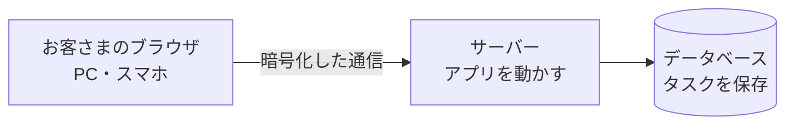

# 要件定義書：タスク管理アプリ（カンバンボード）

| 項目 | 内容 |
|---|---|
| 文書番号 | REQ-001 |
| 版数 | 1.3 |
| 作成日 | 2026-11-15 |
| 更新日 | 2026-11-19 |
| 提出先 | 【クライアント名】様 |
| 作成者 | 【作成者名】 |
| 状態 | ご確認依頼中 |

### 改訂履歴

| 版数 | 日付 | 内容 | 作成者 |
|---|---|---|---|
| 1.0 | 2026-11-15 | 初版 | 【作成者名】 |
| 1.1 | 2026-11-17 | 機能・画面・データベース・API・技術の詳細を別の資料に分け、この文書には概要とリンクを残した | 【作成者名】 |
| 1.2 | 2026-11-17 | ご指定に合わせて、使う技術を Java + Spring Boot（サーバー）、React（画面）、PostgreSQL（データベース）に変更した。それに伴い、休止後の表示までの時間を1〜2分に変更した | 【作成者名】 |
| 1.3 | 2026-11-19 | 「13. 未決事項」に、試作版に登録したタスクの扱い（Q5）を追加した | 【作成者名】 |

---

## 1. はじめに

### 1.1 この文書の目的

この文書は、【クライアント名】様（以下「お客さま」）からご依頼いただいたタスク管理アプリについて、**作るもの・作らないもの・完成の基準**をお客さまと開発者の間で合意するためのものです。
「13. 未決事項」にお答えいただいたうえで、問題がなければ「14. 承認」にご記入ください。ご確認いただいた内容をもとに設計・開発に進みます。

### 1.2 関連資料

この文書には要件の概要を書き、詳しい内容は次の資料にまとめています。

| 資料 | 内容 | 主な読み手 |
|---|---|---|
| [機能仕様書](features.md) | 機能一覧、各機能の詳しい内容、利用シナリオ | お客さま・開発者 |
| [画面設計書](screens.md) | 画面一覧、画面の移り変わり、画面イメージ、画面の動き、入力のルール、エラー時の表示 | お客さま・開発者 |
| [データベース設計書](database.md) | ER図、テーブル定義、データの流れ、タスクの状態の移り変わり | 開発者 |
| [API設計書](api.md) | サーバーの構成、API の一覧と詳細、ログインの仕組み | 開発者 |
| [技術スタック選定書](tech-stack.md) | 使う技術と選んだ理由、比べた候補、無料プランの注意点 | お客さま・開発者 |

### 1.3 用語の説明

| 用語 | 意味 |
|---|---|
| タスク | やるべきこと1件。アプリの画面では「カード」として表示する |
| カラム（列） | タスクの状態を表す縦の列。「未着手」「進行中」「完了」の3つ |
| カンバンボード | カラムを横に並べ、タスクのカードを列から列へ動かして状態を管理する画面の形式 |
| ドラッグ＆ドロップ | マウスでカードをつかんで、別の場所に動かして離す操作 |
| ログイン | パスワードを入力して、アプリを使える状態にすること |
| サーバー | インターネット上でアプリを動かし、データを保存しておくコンピューター |
| データベース | タスクのデータを整理して保存しておく仕組み |
| 無料プラン | サーバーやデータベースを提供する会社の、費用がかからない利用プラン。性能や稼働に制限がある |

---

## 2. プロジェクト概要

### 2.1 背景（お客さまの現状と課題）

- お客さまは、日々のやることをメモや頭の中で管理している
- そのため、次のことに困っている
  - やることを忘れてしまうことがある
  - 何が終わっていて、何が残っているのかをすぐに把握できない
  - たくさんあるやることの中から、何から手をつければよいか判断しにくい
- 会社の PC と外出先のスマートフォンの両方から、同じ内容を確認したい

### 2.2 目的

やることを「未着手」「進行中」「完了」の3つの状態に分けて画面に並べ、**状態をひと目で把握できるようにする**。

### 2.3 導入によって期待する効果

| 今の課題 | 導入後 |
|---|---|
| やることを忘れる | 思いついたときにすぐ登録でき、一覧で見返せる |
| 進み具合が分からない | 列ごとの件数と並びで、残っているものと終わったものがすぐ分かる |
| 何から手をつけるか迷う | 優先度順・期限順に並べ替えて、最初にやることを決められる |
| PC とスマホで内容が別々 | どちらからでも同じ内容を見て、更新できる |

### 2.4 利用者

- お客さま1名
- ほかの人との共有や、複数人での利用は行わない

### 2.5 利用環境

- インターネットにつながった PC・タブレット・スマートフォンの Web ブラウザ
- アプリのインストールは不要。決まった URL をブラウザで開いて使う

---

## 3. 利用シナリオ

タスクは「登録 → 着手（進行中へ移動）→ 更新 → 完了（完了へ移動）→ 削除」の順に扱います。
主な使い方は次のとおりです。PC とスマホでの操作の違いや、1日の使い方の例は [機能仕様書](features.md#2-利用シナリオ) を参照してください。

| No. | シナリオ |
|---|---|
| UC0 | パスワードでログインして使い始める |
| UC1 | 思いついたタスクを登録する |
| UC2 | タスクに説明・優先度・期限を足す |
| UC3 | タスクを「進行中」「完了」へ移して、作業の状態を変える |
| UC4 | 優先度順・期限順に並べ替えて、何から手をつけるか決める |
| UC5 | 終わったタスクを削除して片付ける |

---

## 4. 機能要件

機能の一覧です。各機能の詳しい内容は [機能仕様書](features.md#1-機能一覧) を参照してください。

| No. | 機能 | 概要 |
|---|---|---|
| F1 | ログイン | パスワードでログインする。30日間ログインしたままにでき、ログアウトもできる |
| F2 | ボード表示 | 「未着手」「進行中」「完了」の3つの列と、各列の件数を表示する |
| F3 | タスクの登録 | 列の入力欄にタイトルを入れて登録する。説明・優先度・期限も持てる |
| F4 | タスクの編集 | 詳細画面で各項目を編集する。内容は自動で保存する |
| F5 | タスクの削除 | 「×」または詳細画面から削除する |
| F6 | タスクの移動 | PC はドラッグ＆ドロップ、スマホは詳細画面で、別の列へ移す |
| F7 | 手動の並べ替え | 同じ列の中で順番を入れ替える |
| F8 | 自動の並べ替え | 優先度順・期限順・登録順のどれかで、全部の列を並べ替える |
| F9 | データの保存 | サーバーに保存し、PC とスマホで同じ内容を見られる |
| F10 | スマートフォン対応 | 画面幅が狭いときは列を縦に並べ、スマホでもすべての機能を使える |
| F11 | 背景写真 | 海外の有名な建築物の写真を背景に表示する |

---

## 5. 非機能要件

### 5.1 対応する端末とブラウザ

| 区分 | OS | ブラウザ |
|---|---|---|
| PC | Windows | Google Chrome、Microsoft Edge |
| PC | macOS | Safari、Google Chrome |
| タブレット | iPadOS | Safari |
| スマホ | iOS | Safari |
| スマホ | Android | Google Chrome |

- いずれも、納品時点の最新版を対象とする

### 5.2 表示

- スマホ（画面幅 360px）から大きなパソコン画面（1920px）まで、横にスクロールせずに表示できる
- 端末が暗い配色の設定（ダークモード）のときは、暗い配色で表示する

### 5.3 速さ

- タスクが100件あっても、登録・移動・編集の結果がすぐ画面に反映される
- 普段は、ページを開いてから2秒以内にボードを表示する
- **ただし、15分以上だれも使っていなかったときは、サーバーが休止しているため、表示まで1〜2分ほどかかる**（「8. 前提条件・了承事項」を参照）。その間は「起動しています」と表示する

### 5.4 使いやすさ

- タスクの登録は、タイトルを入力して Enter キーを押すだけでできる
- 初めて使う人でも、説明を読まずに登録・移動・編集ができる
- キーボードだけでもすべての機能を使える（ドラッグ＆ドロップの代わりに、詳細画面の「ステータス」と「上へ」「下へ」を使う）

### 5.5 アクセシビリティ（だれでも使いやすくするための配慮）

- 文字と背景の色の差を十分にとり、見やすくする（国際的な基準 WCAG 2.1 の AA を目安にする）
- 優先度などを色だけで区別せず、「優先度: 高」のように文字でも表示する
- スクリーンリーダー（画面の読み上げソフト）への対応は最低限とする。記号だけのボタン（「×」など）に読み上げ用の名前を付けるが、読み上げソフトでの動作確認は行わない

### 5.6 安全性

- パスワードを知らない人は、タスクを見ることも変更することもできない
- 通信はすべて暗号化する（URL が `https://` で始まる）
- 入力した文字は文字として表示し、プログラムとして動かないようにする
- お客さまの名前やメールアドレスなどの個人情報は保存しない

---

## 6. 画面構成

| No. | 画面名 | 内容 |
|---|---|---|
| S0 | ログイン画面 | パスワードを入力する |
| S1 | ボード画面 | 3つの列とタスクを表示する。登録・移動・並べ替え・ログアウトを行う |
| S2 | タスク詳細画面 | ボード画面の上に重ねて表示する。編集・削除・列の移動・上下の並べ替えを行う |

画面の移り変わり、画面イメージ、画面の動き、エラー時の表示は [画面設計書](screens.md) を参照してください。

---

## 7. 対象外（今回は作らないもの）

- 複数人での利用、ほかの人との共有、担当者の設定
- パスワードを忘れたときに画面から再設定する機能（開発者に依頼して変更する）
- 別の端末での変更を、開いている画面に自動で反映すること
- 列の追加・削除・名前の変更
- インターネットにつながっていないときの利用
- スマホでのドラッグ＆ドロップ（詳細画面の操作で代わりにする）
- データの定期的なバックアップ
- 優先度ごとのカードの色分け、期限切れの強調表示（今後の追加候補）

---

## 8. 前提条件・了承事項

費用を抑えるため、サーバーとデータベースは無料プランを使います。そのため、次の点をご了承ください。

| No. | 内容 |
|---|---|
| P1 | **表示の遅れ**：15分以上使っていないとサーバーが休止します。次に開くときは、表示まで1〜2分ほどかかります |
| P2 | **稼働の保証なし**：提供会社の都合でサービスが止まることがあり、その間は使えません。稼働時間の保証はできません |
| P3 | **データのバックアップなし**：提供会社の障害などでデータが失われた場合、元に戻せないことがあります |
| P4 | **利用条件の変更**：無料プランの条件は提供会社によって変わることがあります。条件が変わり使えなくなった場合は、有料プランへの切り替えなどをご相談します |
| P5 | **インターネット接続**：使うときは常にインターネット接続が必要です |
| P6 | **背景写真**：利用が許可された写真だけを使い、ライセンスが求める撮影者名などを画面に表示します |

---

## 9. システム構成の概要

- 画面、サーバー、データベースはすべてインターネット上のサービスで動かすため、お客さまの端末に何かを入れる必要はありません
- データベースには「列」と「タスク」の2種類のデータを保存します。データの構成（ER図）とデータの流れは [データベース設計書](database.md) を参照してください
- 使う技術は次のとおりです。選んだ理由は [技術スタック選定書](tech-stack.md) を参照してください

| 区分 | 使うもの |
|---|---|
| 画面 | React（TypeScript）。Next.js は使わない |
| サーバー | Java、Spring Boot |
| データベース | PostgreSQL |
| サーバー・データベースの置き場所 | Render、Neon（どちらも無料プラン） |
| ソースコードの管理 | GitHub |

---

## 10. 納品物

| No. | 納品物 | 内容 |
|---|---|---|
| D1 | アプリ | 公開 URL で使える状態にしたアプリ |
| D2 | ソースコード | GitHub のリポジトリ |
| D3 | 要件定義書 | この文書 |
| D4 | 設計書 | 機能仕様書、画面設計書、データベース設計書、API設計書、技術スタック選定書 |
| D5 | 操作説明書 | ログインから削除までの使い方 |
| D6 | テスト結果報告書 | 「12. 受け入れ基準」の確認結果 |

---

## 11. スケジュール

| No. | 工程 | 内容 | 目安の期間 | 終わる日 |
|---|---|---|---|---|
| 1 | 要件定義 | この文書の作成とご承認 | 1週間 | 【日付】 |
| 2 | 設計 | 画面・データ・システムの設計 | 1週間 | 【日付】 |
| 3 | 開発 | アプリの作成 | 2週間 | 【日付】 |
| 4 | テスト | 開発者による動作確認 | 1週間 | 【日付】 |
| 5 | 受け入れ確認 | お客さまによる確認（「12. 受け入れ基準」） | 1週間 | 【日付】 |
| 6 | 納品 | 納品物のお渡し | — | 【日付】 |

- 日付は、この文書のご承認後に決めて記入します

---

## 12. 受け入れ基準

「5.1 対応する端末とブラウザ」のうち、PC（Windows の Chrome）とスマホ（iPhone の Safari）で、次のすべてが確認できたら完成とします。

| No. | 確認すること | 期待する結果 |
|---|---|---|
| T1 | 正しいパスワードでログインする | ボード画面が表示される |
| T2 | 間違ったパスワードでログインする | 「パスワードが違います」と表示され、ボードは表示されない |
| T3 | 「未着手」にタイトルを入力して Enter（スマホは「追加」） | 「未着手」の一番下にカードが追加され、件数が1増える |
| T4 | タイトルを空のまま追加する | カードは追加されない |
| T5 | カードを開いて説明・優先度・期限を変え、閉じる | カードに優先度と期限が表示される。開き直すと説明も変わっている |
| T6 | PC でカードを「進行中」へドラッグ＆ドロップする | カードが「進行中」の落とした位置に移り、両方の列の件数が変わる |
| T7 | スマホで詳細画面の列を「完了」に変える | カードが「完了」の一番下に移る |
| T8 | 「上へ」「下へ」を押す | 同じ列の中で順番が1つ入れ替わる |
| T9 | 優先度順・期限順・登録順でそれぞれ並べ替える | [機能仕様書](features.md) の F8 の順に並ぶ |
| T10 | カードの「×」で削除する | 確認のメッセージが出て、OK を押すとカードが消え、件数が1減る。キャンセルなら消えない |
| T11 | 詳細画面の「削除」を押す | 確認メッセージが出て、OK なら消え、キャンセルなら残る |
| T12 | PC で変更したあと、スマホでページを開く | PC で変更した内容が表示される |
| T13 | ブラウザを閉じて開き直す | ログインしたまま、前回の内容が表示される |
| T14 | 「ログアウト」を押す | ログイン画面に戻り、パスワードを入れるまでボードは表示されない |
| T15 | タイトルに `<b>太字</b>` と入力して登録する | 文字のまま表示され、太字にはならない |

---

## 13. 未決事項

ご承認の前に、次の点についてお考えをお聞かせください。

| No. | 内容 | 開発者からの案 |
|---|---|---|
| Q1 | ログインしたままにする期間 | 30日 |
| Q2 | ページを開いてから表示されるまでの目安 | 2秒以内（休止中を除く） |
| Q3 | 納品後の不具合の対応（期間と範囲） | 【別途ご相談】 |
| Q4 | 開発費用 | 別途お見積りします。サーバーとデータベースの利用料は無料プランのため0円 |
| Q5 | 試作版（ブラウザにデータを保存する版。GitHub Pages で公開中）に登録したタスクの扱い | 新しいアプリには移さず、必要なタスクは新しいアプリで登録し直していただく。試作版は、新しいアプリの公開後に公開を終了する。試作版と新しいアプリは URL が別で、データも引き継がれないため |

---

## 14. 承認

上記の内容で合意します。

| 立場 | 氏名 | 日付 | 署名 |
|---|---|---|---|
| お客さま | | | |
| 開発者 | | | |
