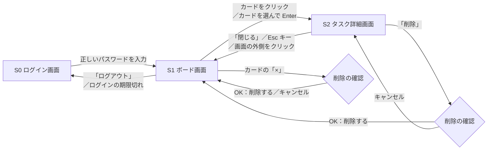

# 画面設計書：タスク管理アプリ（カンバンボード）

[要件定義書](requirements.md) の「6. 画面構成」を詳しくした資料です。
各画面で使う機能の内容は [機能仕様書](features.md) を参照してください。

---

## 1. 画面一覧と画面の移り変わり

### 1.1 画面一覧

| No. | 画面名 | 内容 | 使う機能 |
|---|---|---|---|
| S0 | ログイン画面 | パスワードを入力する。ログインしていないときに表示する | F1 |
| S1 | ボード画面 | 3つの列とタスクを表示する。登録・移動・並べ替え・ログアウトを行う | F1〜F3、F5〜F8、F11 |
| S2 | タスク詳細画面 | ボード画面の上に重ねて表示する。編集・削除・ステータス（列）の変更・上下の並べ替えを行う | F4〜F7 |
| — | 削除の確認 | カードの「×」か、詳細画面の「削除」を押したときに出す確認メッセージ（ブラウザ標準の確認ダイアログ） | F5 |

- 画面は1枚のページの中で切り替えて表示する（別のページへは移動しない）

### 1.2 画面の移り変わり



---

## 2. 画面イメージと画面の動き

### 共通：データの保存のしかた

- 操作したら、先に画面を書き換え、そのあとサーバーに保存する（操作のたびに待たされないようにするため）
- 保存に失敗したら、エラーを表示し、ボードをデータベースの内容で読み込み直す（画面とデータベースの食い違いをなくすため）
- タイトルと説明は、1文字ごとではなく、入力が 0.5 秒止まったときにまとめて保存する（通信の回数を減らすため）

### 2.1 S0 ログイン画面

```text
┌──────────────────────────────┐
│ ボード                       │
│                              │
│ パスワード                   │
│ [••••••••                  ] │
│                    [ログイン]│
│                              │
│ パスワードが違います         │ ← 間違えたときだけ表示
└──────────────────────────────┘
```

| 要素 | 操作 | 動き |
|---|---|---|
| 画面全体 | 表示 | ページを開いたときに、ログインしていなければ表示する |
| パスワード | 入力 | 入力した文字は「•」で隠す |
| ログインボタン | 押す／Enter | パスワードが正しければボード画面を表示する。間違っていれば入力欄の下に「パスワードが違います」と表示し、入力欄を空にする。返事を待っている間はボタンを押せない |

### 2.2 S1 ボード画面

#### PC（画面幅 720px 以上）

```text
┌───────────────────────────────────────────────────────────┐
│ ボード             [優先度順 ▼] [並べ替え] [ログアウト]   │ ← ヘッダー
├───────────────────────────────────────────────────────────┤
│ ┌ 未着手      2 ┐  ┌ 進行中      1 ┐  ┌ 完了        0 ┐   │ ← 見出しと件数
│ │┌────────────┐│  │┌────────────┐│  │               │   │
│ ││資料を作る ×││  ││買い物     ×││  │               │   │ ← カード
│ ││[高]        ││  ││[中]        ││  │               │   │
│ ││期限:11/20  ││  │└────────────┘│  │               │   │
│ │└────────────┘│  │               │  │               │   │
│ │┌────────────┐│  │               │  │               │   │
│ ││本を返す   ×││  │               │  │               │   │
│ ││[低]        ││  │               │  │               │   │
│ │└────────────┘│  │               │  │               │   │
│ │[カードを追加…][追加]│[カードを追加…][追加]│[カードを追加…][追加]│ ← 入力欄
│ └──────────────┘  └──────────────┘  └──────────────┘   │
│                                  写真: 撮影者 / ライセンス │ ← クレジット
└───────────────────────────────────────────────────────────┘
```

#### スマホ（画面幅 720px 未満）

```text
┌─────────────────────┐
│ ボード              │
│ [優先度順 ▼][並べ替え]│
│ [ログアウト]        │
├─────────────────────┤
│ ┌ 未着手        2 ┐ │
│ │ [資料を作る   ×] │ │
│ │ [本を返す     ×] │ │
│ │ [カードを追加…][追加]│
│ └─────────────────┘ │
│ ┌ 進行中        1 ┐ │
│ │ [買い物       ×] │ │
│ │ [カードを追加…][追加]│
│ └─────────────────┘ │
│ ┌ 完了          0 ┐ │
│ │ [カードを追加…][追加]│
│ └─────────────────┘ │
└─────────────────────┘
```

- 図の `[高]` は優先度の色付きのバッジ。期限は図では「期限:11/20」と短く書いているが、実際は「期限: 2026/11/20」と表示する
- ボードの横幅は最大 1100px とし、それより広い画面では中央に寄せる

| 要素 | 操作 | 動き |
|---|---|---|
| 画面全体 | 表示 | ページを開いたら、データベースからボードの内容を読み込んで表示する。読み込みに3秒以上かかったら「サーバーを起動しています。1〜2分ほどかかることがあります」と表示する。読み込みが終わるまでは列を表示せず、「並べ替え」ボタンも押せない |
| 並べ方（選択肢） | 選ぶ | 「優先度順」「期限順」「登録順」から選ぶ。選んだだけでは並べ替えない |
| 並べ替えボタン | 押す | 選んだ並べ方で全部の列を並べ替え、その順番を保存する |
| ログアウトボタン | 押す | ログアウトして、ログイン画面を表示する |
| 列の見出し | — | 列の名前と、その列のタスクの件数を表示する |
| カード | 表示 | タイトルと優先度を表示する。優先度は色付きのバッジ（高＝赤・中＝黄・低＝青、文字は白）で表示する。期限は設定されているときだけ「期限: YYYY/MM/DD」で表示する。登録してサーバーの返事を待っている間は薄く表示し、開く・ドラッグ・削除はできない |
| カード | クリック／Enter | S2 タスク詳細画面を開く |
| カード | ドラッグ | ドラッグ中のカードを薄く表示し、落とす位置に青い線を出す。落とすと、その位置に移動して保存する。列の上にあるときは、その列の枠を青くする |
| 「×」ボタン | 押す | 「『タイトル』を削除しますか？」と確認し、OK ならタスクを削除する。マウスのある端末では、カードにマウスを乗せたときとキーボードでカードを選んだときだけ表示する（スマホではいつも表示する） |
| 入力欄・追加ボタン | Enter／押す | その列の一番下にタスクを登録する。登録後も入力欄にカーソルを残す |
| クレジット | クリック | 背景写真の出典ページを新しいタブで開く |

### 2.3 S2 タスク詳細画面

```text
┌──────────────────────────────┐
│ カードの詳細                 │
│ タイトル                     │
│ [資料を作る                ] │
│ 説明                         │
│ [                          ] │
│ [                          ] │
│ 優先度          期限         │
│ [高 ▼]          [2026/11/20] │
│ ステータス      [上へ][下へ] │
│ [未着手][進行中][完了]       │
│ [削除]                [閉じる]│
└──────────────────────────────┘
  ※ 後ろのボード画面は暗く表示する
```

| 要素 | 操作 | 動き |
|---|---|---|
| 画面全体 | 開く | ボード画面の上に重ねて表示し、後ろを暗くする。開いている間はボード画面を操作できない |
| タイトル | 入力 | 入力が 0.5 秒止まったら保存し、ボード画面にも反映する。Enter キーを押すと「閉じる」と同じく画面を閉じる |
| 説明 | 入力 | 入力が 0.5 秒止まったら保存する |
| 優先度・期限 | 変更 | 変更した時点で保存する。優先度の選択欄は、選んでいる優先度の色（カードのバッジと同じ）で表示する。期限はブラウザ標準の日付選択を使う |
| ステータス | 押す | 列の数だけボタンを並べ、今の列のボタンを青く表示する。ほかのボタンを押すと、その列の一番下に移動して保存する |
| 上へ／下へ | 押す | 同じ列の隣のタスクと順番を入れ替える。一番上のときは「上へ」、一番下のときは「下へ」を押せなくする |
| 削除ボタン | 押す | 「『タイトル』を削除しますか？」と確認し、OK なら削除して画面を閉じる |
| 閉じるボタン／Esc／外側のクリック | 押す | まだ保存していない入力があれば保存してから、画面を閉じる |

---

## 3. 入力のルール

画面とサーバーの両方で同じルールを確かめる。画面での確認は使いやすさのため、サーバーでの確認は正しくないデータをデータベースに入れないため。

| 項目 | 必須 | ルール |
|---|---|---|
| タイトル | 必須 | 前後の空白は取り除いて保存する。空白だけのものは空とみなす。文字数の上限は設けない |
| 説明 | 任意 | 入力したまま保存する（前後の空白も残す）。改行できる。文字数の上限は設けない |
| 優先度 | 必須 | 「高」「中」「低」から選ぶ。登録したときは「中」 |
| 期限 | 任意 | ブラウザ標準の日付選択で入力する。過去の日付も設定できる（期限切れのタスクも登録できるようにするため）。空にすると期限なし |
| 列 | 必須 | 「未着手」「進行中」「完了」から選ぶ。登録したときは入力欄のある列 |
| パスワード | 必須 | 空のままではログインボタンを押せない |

---

## 4. うまくいかなかったときの表示

エラーのメッセージは、画面の上部に帯で表示し、5秒後に消す（「再読み込み」ボタンのある帯は自動では消さない。ログイン画面のメッセージは入力欄の下に出す）。

| 場面 | 画面の表示・動き |
|---|---|
| パスワードが違う | ログイン画面に「パスワードが違います」と表示する |
| ログインのときに通信できない・サーバーがエラーを返した | ログイン画面に「ログインできませんでした。通信状況を確認してください」と表示し、入力欄を空にする |
| タイトルを入れずに追加しようとした（空白だけも含む） | 何も登録しない。メッセージは出さない |
| 詳細画面でタイトルを空にした | 空の間は保存しない。入力欄から離れると元のタイトルに戻す |
| サーバーが休止から起動している | 「サーバーを起動しています。1〜2分ほどかかることがあります」と表示する |
| 通信できない・サーバーがエラーを返した | 「保存できませんでした。通信状況を確認してください」と表示し、ボードを読み込み直す |
| ボードを読み込めなかった | 画面上部の帯に「読み込めませんでした」と「再読み込み」ボタンを出し（自動では消さない）、列の代わりにも「読み込めませんでした」と表示する |
| ログアウトのときに通信できない・サーバーがエラーを返した | 「ログアウトできませんでした。通信状況を確認してください」と表示し、ボード画面のままにする |
| ログインの期限（30日）が切れた | ログイン画面を表示する |
| 背景写真が読み込めない | 写真なしの通常の配色で表示する。クレジットも出さない |
