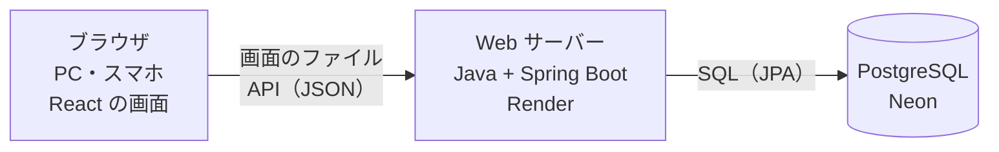

# 技術スタック選定書：タスク管理アプリ（カンバンボード）

[要件定義書](requirements.md) をもとに、アプリをどんな技術で作るかと、その理由をまとめた資料です。

> 状態：**確定**（2026-11-17 更新。お客さまのご指定に合わせて、サーバーを Java + Spring Boot、画面を React に変更）

---

## 1. 選ぶときの前提と、重視したこと

### 1.1 お客さまのご指定

| 区分 | ご指定 |
|---|---|
| サーバー（バックエンド） | Java と Spring Boot を使う |
| 画面（フロントエンド） | React を使う。Next.js は今回は使わない |
| データベース | PostgreSQL を使う |
| そのほかのツール | 上の言語・フレームワークに合わせて選ぶ |

### 1.2 ご指定以外を選ぶときに重視したこと

| 重視したこと | 内容 | 関係する要件 |
|---|---|---|
| 相性 | Spring Boot と React で標準的に使われている組み合わせを選ぶ | — |
| 費用 | サーバーとデータベースの利用料を0円にする | 要件定義書 8章・13章 |
| 端末 | PC とスマホのブラウザから、同じデータを見られる | 要件定義書 2.5 |
| 安全性 | 1人で使うアプリでも、パスワードで守る | 要件定義書 5.6 |
| 保守・引き継ぎ | 広く使われているものを選び、部品を必要以上に増やさない。将来ほかの開発者に引き継いだり、別のサービスへ引っ越したりしやすくする | — |

---

## 2. 全体構成

- React の画面は、公開する前に HTML・CSS・JavaScript のファイルに変換（ビルド）し、Spring Boot のアプリに入れて一緒に配信する（詳しくは [API設計書](api.md)）。画面と API の URL がそろうので、設定が簡単になり、ログイン状態も安定して保てる
- 公開するのは Spring Boot のアプリ1つだけなので、サーバーも1つで済む

---

## 3. 選定結果

### 3.1 サーバー（バックエンド）

| 区分 | 採用 | 理由 |
|---|---|---|
| 言語 | Java（動作確認時点の LTS 版） | ご指定。LTS 版（長期サポート版）は、安全のための更新が長く提供される |
| フレームワーク | Spring Boot（動作確認時点の最新の安定版） | ご指定。Java の Web アプリで最も広く使われている |
| ビルドツール | Gradle | Spring Boot の公式のひな形（Spring Initializr）で標準の選択肢。ライブラリの管理とビルド・テストの実行をまとめて行える |
| API の作成 | Spring Web MVC（spring-boot-starter-webmvc） | Spring Boot の標準の部品で、JSON の API を作れる |
| データベースへの接続 | Spring Data JPA ＋ PostgreSQL の JDBC ドライバー | Spring Boot で最も広く使われている方法。簡単な読み書きは SQL を書かずにでき、送られた値は自動でプレースホルダーとして渡されるので、SQL インジェクションを防げる |
| テーブルの作成・変更 | Flyway | テーブルを作る SQL をファイルとして残し、サーバーの起動時に自動で適用する。変更の履歴も番号付きのファイルで残るので、どのような形でデータを保存しているかがだれにでも分かる |
| 入力のチェック | Bean Validation（spring-boot-starter-validation） | 「タイトルは空にできない」などのルールを、項目に注釈を付けるだけで書ける |
| ログイン | Spring Security ＋ Spring Session JDBC | Spring の標準の安全対策の部品。ログイン状態をデータベースに保存するので、サーバーが休止・再起動してもログインが切れない |
| テスト | JUnit 5 ＋ Spring Boot Test | Spring Boot に最初から入っているテストの部品 |

### 3.2 画面（フロントエンド）

| 区分 | 採用 | 理由 |
|---|---|---|
| ライブラリ | React | ご指定。Next.js は使わない（ご指定） |
| 言語 | TypeScript | JavaScript に「型」を付けたもの。API で受け取るデータの形を決めておけるので、サーバーとのずれや書き間違いに、動かす前に気づける。React で広く使われている |
| ビルドツール・開発用サーバー | Vite | Next.js を使わずに React を始めるときの、現在の標準的な選択肢。保存するとすぐ画面に反映され、開発しやすい |
| 見た目 | CSS（ライブラリなし） | 画面が3つだけの小さな規模なので、見た目のライブラリはいらない。今のアプリの CSS（ダークモードの対応など）をそのまま活かせる |
| ドラッグ＆ドロップ | ブラウザの標準の機能（HTML5 Drag and Drop API） | 今のアプリと同じ動きをライブラリなしで作れる。スマホは詳細画面で移動する設計なので、タッチ操作に対応したライブラリはいらない |
| サーバーとの通信 | ブラウザの標準の機能（fetch） | API が8つだけなので、通信用のライブラリはいらない |
| テスト | Vitest ＋ React Testing Library | Vite と同じ設定で動き、画面の部品ごとに動きを確かめられる |
| 開発に使う道具 | Node.js（動作確認時点の LTS 版） | Vite と TypeScript を動かすために、開発する人のパソコンとビルドのときだけ使う。公開するサーバーでは使わない |

### 3.3 データベース・置き場所・管理

| 区分 | 採用 | 理由 |
|---|---|---|
| データベース | PostgreSQL | ご指定。世界中で広く使われている無料のデータベース |
| サーバーの置き場所 | Render（無料プラン、Docker で動かす） | 費用がかからない。プログラムを更新すると自動で反映される。Java は標準では選べないため、Docker（アプリを動かす環境ごとまとめる仕組み）で動かす |
| データベースの置き場所 | Neon（無料プラン） | 費用がかからず、期限なしで使える PostgreSQL |
| 開発用のデータベース | 開発する人のパソコンの PostgreSQL（Docker で動かす） | 本番のデータに影響を与えずに、開発や確認ができる |
| ソースコードの管理 | Git / GitHub | 変更の履歴がすべて残る。引き継ぐときは、このリポジトリを渡せばよい |

---

## 4. 比べたもの

ご指定の技術（Java・Spring Boot・React・PostgreSQL）以外で、候補を比べたものです。

### 4.1 サーバー側

| 区分 | 候補 | 良い点 | 採用しなかった理由 |
|---|---|---|---|
| ビルドツール | **Gradle** | 設定が短く書ける。公式のひな形で標準 | （採用） |
| | Maven | 歴史が長く、資料が多い | どちらでも作れるが、公式のひな形で標準の Gradle に合わせた |
| データベースへの接続 | **Spring Data JPA** | 簡単な読み書きに SQL がいらない。最も広く使われている | （採用） |
| | MyBatis | SQL を自分で書けて、細かく調整しやすい | SQL をすべて書く必要があり、この規模では手間が増える |
| テーブルの作成・変更 | **Flyway** | SQL ファイルをそのまま使え、分かりやすい | （採用） |
| | Liquibase | XML などで書け、多くのデータベースに対応する | 書き方を覚える必要があり、この規模では機能が多すぎる |
| ログイン状態の保存 | **Spring Session JDBC** | データベースに保存するので、再起動してもログインが切れない | （採用） |
| | サーバーのメモリに保存（Spring の初期設定） | 設定がいらない | 無料のサーバーは15分で休止するので、そのたびにログインし直しになる |
| | JWT（トークンを画面側で持つ方法） | サーバーに保存しなくてよい | 仕組みが複雑になり、ログアウトさせる方法も別に作る必要がある |

### 4.2 画面側

| 区分 | 候補 | 良い点 | 採用しなかった理由 |
|---|---|---|---|
| 言語 | **TypeScript** | 書き間違いに動かす前に気づける | （採用） |
| | JavaScript | 覚えることが少ない | データの形のずれに、動かすまで気づけない |
| ビルドツール | **Vite** | 速く、設定が少ない | （採用） |
| | Create React App | 以前の標準 | 公式に非推奨になっている |
| | Next.js | 機能が多い | ご指定により対象外 |
| ドラッグ＆ドロップ | **ブラウザの標準の機能** | ライブラリがいらない | （採用） |
| | dnd-kit | スマホのタッチ操作でも動かせる | スマホは詳細画面で移動する設計なので、部品を増やすほどの利点がない |

### 4.3 置き場所

| 区分 | 候補 | 良い点 | 採用しなかった理由 |
|---|---|---|---|
| サーバー | **Render** | 無料プランがあり、Docker で Java を動かせる。GitHub と連携して自動で公開できる | （採用） |
| | 自社のパソコンやレンタルサーバー | 自由に設定できる | 常に動かしておく手間や、費用がかかる |
| データベース | **Neon** | 無料で期限なし。使わないときは自動で休止する | （採用） |
| | Render の PostgreSQL | サーバーと同じ管理画面で扱える | 無料のデータベースは作成から30日で期限が切れ、猶予期間のあとデータごと削除される |
| | Supabase | ログインの仕組みなども付いている | そのサービス独自の機能に頼る部分が増え、将来の引っ越しが難しくなる。無料プランは、使わない期間が続くと一時停止する |

---

## 5. 無料プランで気をつけること

条件は変わることがあるため、使い始める前に公式ページで確認する（2026年11月時点で調べた内容）。

- **Render の無料サーバー**
  - 15分間アクセスがないと停止し、次のアクセスで起動し直す。Java のアプリは起動に時間がかかるため、**表示まで1〜2分ほどかかる**
  - 使えるメモリが少ない（512MB）。Java が使うメモリの上限を設定して動かす
  - サーバー内に保存したファイルは、再起動などで消える（データとログイン状態は必ずデータベースに保存する）
  - 1か月に動かせる時間に上限がある（ワークスペース全体で750時間）
- **Neon の無料プラン**
  - 5分間使わないと自動で休止し、次のアクセスで自動で再開する（休止は無料プランでは止められない）
  - 保存容量・計算時間・通信量に月ごとの上限がある。上限に達すると、翌月までデータベースが止まる
  - 1人で使うタスク管理なら、上限に届くことはまずない

→ そのため、[要件定義書](requirements.md) の「5.3 速さ」と「8. 前提条件・了承事項」に、休止中は表示まで1〜2分ほどかかることを書いている。

---

## 参考

- [Spring Initializr](https://start.spring.io/)
- [Vite](https://vite.dev/)
- [Deploy for Free – Render Docs](https://render.com/docs/free)
- [Docker – Render Docs](https://render.com/docs/docker)
- [Neon Free plan limits and quotas](https://neon.com/faqs/free-plan-limits-and-quotas)
- [Neon Pricing](https://neon.com/pricing)
