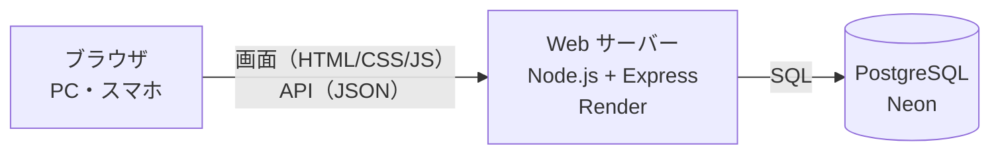

# 技術スタック選定書：タスク管理アプリ（カンバンボード）

[要件定義書](requirements.md) をもとに、アプリをどんな技術で作るかと、その理由をまとめた資料です。

> 状態：**確定**（2026-11-13）

---

## 1. 選ぶときに重視したこと

| 重視したこと | 内容 | 関係する要件 |
|---|---|---|
| 費用 | サーバーとデータベースの利用料を0円にする | 要件定義書 8章・13章 |
| 端末 | PC とスマホのブラウザから、同じデータを見られる | 要件定義書 2.5 |
| 安全性 | 1人で使うアプリでも、パスワードで守る | 要件定義書 5.6 |
| 保守・引き継ぎ | 使う技術と部品を少なくし、広く使われているものを選ぶ。将来ほかの開発者に引き継いだり、別のサービスへ引っ越したりしやすくする | — |

---

## 2. 全体構成

- 画面のファイルと API を、同じ Web サーバーから配信する（詳しくは [API設計書](api.md)）。画面と API の URL がそろうので、設定が簡単になり、ログイン状態も安定して保てる

---

## 3. 選定結果

| 区分 | 採用 | 理由 |
|---|---|---|
| 画面（フロントエンド） | HTML / CSS / JavaScript（フレームワークなし） | 画面は3つだけの小さな規模で、フレームワークがなくても作れる。ブラウザの標準の技術だけなので、Web 開発の基本が分かる人ならだれでも保守できる |
| サーバーの言語 | Node.js（動作確認時点の LTS 版） | 画面と同じ JavaScript で書けるため、保守する人に求める言語が1つで済む。LTS 版（長期サポート版）は、安全のための更新が長く提供される |
| Web フレームワーク | Express | Node.js で最も広く使われていて、資料も、引き継げる開発者も見つけやすい。必要な機能だけを使える小さな作り |
| データベース | PostgreSQL | 世界中で広く使われている無料のデータベース。多くのサービスが対応しているので、将来の引っ越しや有料プランへの切り替えがしやすい |
| データベースへの接続 | node-postgres（`pg`） | データベースにつなぐための最小限の部品。部品を増やさないことで、更新や保守の手間を減らす |
| テーブルの作成 | SQL ファイル（`db/schema.sql`） | テーブルの形がファイルとして残るので、どのような形でデータを保存しているかがだれにでも分かり、同じ手順で作り直せる |
| ログイン | パスワード1つ（サーバーの環境変数に置く）＋署名付き Cookie | 利用者が1人なので、ユーザーの登録や管理の仕組みはいらない。パスワードはプログラムの中に書かず、サーバーの設定で管理する |
| サーバーの置き場所 | Render（無料プラン） | 費用がかからない。プログラムを更新すると自動で反映される |
| データベースの置き場所 | Neon（無料プラン） | 費用がかからず、期限なしで使える PostgreSQL |
| 開発用のデータベース | Neon のブランチ（本番の複製） | 本番のデータに影響を与えずに、開発や確認ができる |
| ソースコードの管理 | Git / GitHub | 変更の履歴がすべて残る。引き継ぐときは、このリポジトリを渡せばよい |

---

## 4. 比べたもの

### 4.1 サーバーの言語・フレームワーク

| 候補 | 良い点 | 採用しなかった理由 |
|---|---|---|
| **Node.js + Express** | 画面と同じ言語。広く使われていて資料が多い | （採用） |
| Python + FastAPI | 書きやすく、API の説明書が自動で作られる | 画面とサーバーで言語が分かれ、保守する人に求める知識が増える |
| Ruby on Rails | 機能がそろっていて早く作れる | この規模のアプリには大きすぎ、使わない機能の更新まで管理する必要がある |

### 4.2 データベースとその置き場所

| 候補 | 良い点 | 採用しなかった理由 |
|---|---|---|
| **Neon（PostgreSQL）** | 無料で期限なし。使わないときは自動で休止する | （採用） |
| Render の PostgreSQL | サーバーと同じ管理画面で扱える | 無料のデータベースは作成から30日で期限が切れ、猶予期間のあとデータごと削除される |
| Supabase（PostgreSQL） | ログインの仕組みなども付いている | そのサービス独自の機能に頼る部分が増え、将来の引っ越しが難しくなる。無料プランは、使わない期間が続くと一時停止する |
| Firebase（Firestore） | 手軽に始められる | 表の形でデータを持たない種類のデータベース（NoSQL）で、ほかのサービスへの引っ越しが難しい |

### 4.3 サーバーの置き場所

| 候補 | 良い点 | 採用しなかった理由 |
|---|---|---|
| **Render** | 無料プランがあり、GitHub と連携して自動で公開できる | （採用） |
| 自社のパソコンやレンタルサーバー | 自由に設定できる | 常に動かしておく手間や、費用がかかる |

---

## 5. 無料プランで気をつけること

条件は変わることがあるため、使い始める前に公式ページで確認する（2026年11月時点で調べた内容）。

- **Render の無料サーバー**
  - 15分間アクセスがないと停止し、次のアクセスで起動し直す。起動には1分ほどかかる
  - サーバー内に保存したファイルは、再起動などで消える（データは必ずデータベースに保存する）
  - 1か月に動かせる時間に上限がある（ワークスペース全体で750時間）
- **Neon の無料プラン**
  - 5分間使わないと自動で休止し、次のアクセスで自動で再開する（休止は無料プランでは止められない）
  - 保存容量・計算時間・通信量に月ごとの上限がある。上限に達すると、翌月までデータベースが止まる
  - 1人で使うタスク管理なら、上限に届くことはまずない

→ そのため、[要件定義書](requirements.md) の「5.3 速さ」と「8. 前提条件・了承事項」に、休止中は表示まで1分ほどかかることを書いている。

---

## 参考

- [Deploy for Free – Render Docs](https://render.com/docs/free)
- [Render FAQ](https://docs.render.com/faq)
- [Neon Free plan limits and quotas](https://neon.com/faqs/free-plan-limits-and-quotas)
- [Neon Pricing](https://neon.com/pricing)
