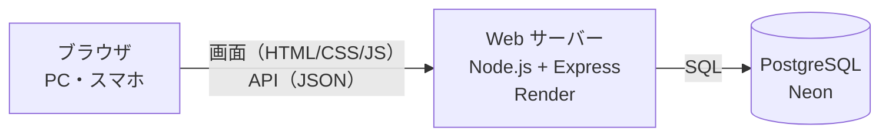

# 技術スタック選定書: タスク管理アプリ（Trello風）

[要件定義書](requirements.md) をもとに、どんな道具を使って作るかを決める。
今の版（データを端末の localStorage に保存）から、バックエンドを作ってデータを DB に保存する版へ移る前提で選ぶ。

> 状態：**確定**（2026-11-13）

---

## 1. 選ぶときの前提

| 前提 | 内容 | 出どころ |
|---|---|---|
| 学習目的 | 開発の流れを一通り経験する。バックエンドと DB の運用まで自分で行う | 要件定義書 1.1 |
| 利用者 | 自分1人。複数ユーザーには対応しない | 要件定義書 1.3 |
| 費用 | 0円（無料のサービスだけを使う） | 要件定義書 8章 |
| 端末 | PC とスマホのブラウザ。DB に保存するので、端末をまたいで同じデータを見られる | 要件定義書 1.4 |
| 安全性 | 公開する API は誰でも呼べるので、1人用でもパスワードで守る | — |

---

## 2. 全体構成

- 画面のファイルと API を、同じ Web サーバーから配信する。画面と API の URL がそろうので、別サイト間の通信の設定（CORS）や、ログイン状態を保持する Cookie の扱いで困らない
- GitHub Pages での公開はやめる（今の版の公開ページは、移行が終わるまで残す）

---

## 3. 選定結果

| 区分 | 採用 | 理由 |
|---|---|---|
| 画面（フロントエンド） | HTML / CSS / JavaScript（フレームワークなし） | 今の版をそのまま活かす。保存先を localStorage から API に変えるだけで済む |
| サーバーの言語 | Node.js（動作確認時点の LTS 版） | 画面と同じ JavaScript で書けるので、新しく覚える言語が増えない |
| Web フレームワーク | Express | Node.js で最も使われていて、資料が多い。小さく始められる |
| DB | PostgreSQL | 実務でよく使われるリレーショナル DB。ER図・SQL の学習に合う |
| DB への接続 | node-postgres（`pg`） | SQL を自分で書いて学ぶため、SQL を隠す ORM（Prisma など）は使わない |
| テーブルの作成 | SQL ファイル（`db/schema.sql`）を手で実行する | 仕組みが見えやすい。作り直しの手順も単純 |
| ログイン | パスワード1つ（サーバーの環境変数に置く）＋署名付き Cookie | ユーザーは1人なので、ユーザーの表やパスワードの保存は不要 |
| サーバーの置き場所 | Render（無料プラン） | GitHub に push すると自動で反映される。Node.js をそのまま動かせる |
| DB の置き場所 | Neon（無料プラン） | 無料のまま期限なしで使える PostgreSQL |
| 開発用の DB | Neon のブランチ（本番 DB の複製） | パソコンに PostgreSQL を入れなくて済む |
| ソースコードの管理 | Git / GitHub | 今と同じ |

---

## 4. 比べたもの

### 4.1 サーバーの言語・フレームワーク

| 候補 | 良い点 | 採用しなかった理由 |
|---|---|---|
| **Node.js + Express** | 画面と同じ言語。資料が多い | （採用） |
| Python + FastAPI | 書きやすく、API の説明書が自動で作られる | 新しく Python を覚える必要がある |
| Ruby on Rails | 機能がそろっていて早く作れる | 仕組みが隠れる部分が多く、規模に対して大きすぎる |

### 4.2 DB とその置き場所

| 候補 | 良い点 | 採用しなかった理由 |
|---|---|---|
| **Neon（PostgreSQL）** | 無料で期限なし。使わないときは自動で休止する | （採用） |
| Render の PostgreSQL | サーバーと同じ管理画面で扱える | 無料の DB は作成から30日で期限が切れ、猶予期間のあとデータごと削除される |
| Supabase（PostgreSQL） | ログインの仕組みなども付いている | 便利な機能が多い分、バックエンドを自分で作る学習から外れる。無料プランは使わない期間が続くと一時停止する |
| Firebase（Firestore） | 手軽に始められる | テーブルではない形（NoSQL）で、ER図の学習に合わない |

### 4.3 サーバーの置き場所

| 候補 | 良い点 | 採用しなかった理由 |
|---|---|---|
| **Render** | 無料プランがあり、GitHub と連携して自動で公開できる | （採用） |
| 自分の PC やレンタルサーバー | 自由に設定できる | 常に動かしておく手間や費用がかかる |

---

## 5. 無料プランで気をつけること

条件は変わることがあるため、使い始める前に公式ページで確認する（2026年11月時点で調べた内容）。

- **Render の無料サーバー**
  - 15分間アクセスがないと停止し、次のアクセスで起動し直す。起動には1分ほどかかる
  - サーバー内に保存したファイルは、再起動などで消える（データは必ず DB に保存する）
  - 1か月に動かせる時間に上限がある（ワークスペース全体で750時間）
- **Neon の無料プラン**
  - 5分間使わないと自動で休止し、次のアクセスで自動で再開する（休止は無料プランでは止められない）
  - 保存容量・計算時間・通信量に月ごとの上限がある。上限に達すると、翌月までDBが止まる
  - 1人で使うタスク管理なら、上限に届くことはまずない

→ 要件定義書の性能要件「ページを開いてから1秒以内に表示」は、サーバーが停止しているときは守れない。要件側を「サーバーが動いているとき」の条件に直す必要がある。

---

## 6. 要件定義書で変わるところ

この選定にあわせて、[要件定義書](requirements.md) の次の箇所を直した。

| 箇所 | 今 | 変更後 |
|---|---|---|
| 1.3 利用者・1.4 利用環境 | ログインなし。端末ごとに別に保存し、同期しない | パスワードでログインする。端末をまたいで同じデータを見られる |
| 3.3 データ保存機能 | localStorage に保存 | サーバーの DB に保存 |
| 4.3 性能 | 表示まで1秒以内 | サーバーが停止しているときは、起動に1分ほどかかることを認める |
| 4.6 安全性 | 外部には送らない | 通信は HTTPS。パスワードがないと読み書きできない |
| 4.7 可用性 | GitHub Pages の稼働に依存 | Render と Neon の稼働に依存 |
| 6章 対象外 | 端末間の同期を対象外にしている | 対象外から外す。複数ユーザー対応を対象外に加える |
| 7章 技術構成 | HTML/CSS/JS・localStorage・GitHub Pages | この選定書の内容に差し替える |
| 8章 制約条件 | localStorage の容量、データ消失の注意 | 無料プランの制限に差し替える |

---

## 参考

- [Deploy for Free – Render Docs](https://render.com/docs/free)
- [Render FAQ](https://docs.render.com/faq)
- [Neon Free plan limits and quotas](https://neon.com/faqs/free-plan-limits-and-quotas)
- [Neon Pricing](https://neon.com/pricing)
